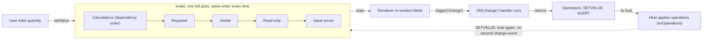

<PageBadges />

import { Callout } from "zudoku/ui/Callout"

The engine does not track which fields a change affects. Whenever something changes, it runs one
full evaluation pass over the whole form, always in the same order. Knowing that order explains
most of what you see at runtime: why a calculated field can drive visibility, why a hidden field
still counts in a calculation, and when event handlers run.

## Creating an engine

`createFormEngine({ schema, initialValues })` prepares the form once. It:

1. Validates the schema and throws if it is invalid. See [Schema validation](/core/schema/validation).
2. Fills in values: the `initialValues` you pass, then each field's `default_value` for everything
   else.
3. Works out which calculated fields depend on which other fields. This happens once, not on every
   evaluation.
4. Runs `form.events.code` once to register event handlers. No event is dispatched at this point.

Creating an engine does not evaluate the form. Visibility, requiredness, and errors stay empty until
the first `engine.eval()`. The official bindings call it immediately after creating the engine.

## One evaluation pass

`engine.eval()` runs these steps in order, every time:

<EngineDiagram name="evaluation-cycle">



</EngineDiagram>

| Step            | What happens                                                                           | Result in state |
| --------------- | -------------------------------------------------------------------------------------- | --------------- |
| 1. Calculations | Every `CalculatedField` runs its `calculate` expression, dependencies first            | `values`        |
| 2. Required     | `required_conditions` is checked, or the static `required` flag is used                | `required`      |
| 3. Visibility   | `visible_conditions` is checked, or the static `visible` flag is used                  | `visible`       |
| 4. Read-only    | `read_only_conditions` is checked, or the static `read_only` flag is used              | `read_only`     |
| 5. Validation   | Each field's value is checked against its own rules, such as `pattern` or number range | `errors`        |

After the pass, `engine.getState()` returns the result. The same values always produce the same
state, no matter in which order the user entered them.

`eval()` also collects calculation diagnostics, such as cycles or expressions that throw. Read them
with `engine.getDiagnostics()`. They do not change `errors`, conditions, or events. See
[Seeing errors and warnings](/core/engine/calculations-dependencies#seeing-errors-and-warnings).

### What the order means for your schema

- **Conditions see calculated values.** Calculations run first, so a `visible_conditions` or
  `required_conditions` can reference a `CalculatedField` and always gets its current value.
- **Calculations ignore visibility.** A hidden field keeps its value by default, so the value is
  still in `values` and still counts in any calculation that references it. To clear it instead, see
  [Clear a value when a field is hidden](/core/fields/common-attributes#clear-a-value-when-a-field-is-hidden).
- **Validation covers every field.** Value errors are computed for hidden fields too. An empty
  required field is not an error in `errors`; the renderer or your application decides whether it
  blocks submission. See [Required fields and submission](/core/schema/validation).
- **Choice conditions compare selected values.** A condition on a choice field compares the selected
  choice `value`, not the whole stored object. See
  [Conditions and operators](/core/schema/conditions-operators).

### Sections follow their children

Visibility is evaluated from the innermost fields outward. A `Section` or `RepeatableSection` whose
children are all hidden is hidden too, whatever its own `visible` or `visible_conditions` say. If at
least one child is visible, the section's own settings apply.

## When a value changes

The engine has no separate "update" step. When a user edits a field, the official bindings:

1. Write the new value into the engine's values.
2. Run `engine.eval()`, which repeats the full pass above.
3. Publish the new state to the UI.
4. Dispatch `change` for the edited field, which runs any matching `ON("change", ...)` handler.

Event handlers never change the form themselves. They return a list of operations, such as
`SETVALUE` or `ALERT`, and the renderer or your application applies them. Applying a `SETVALUE`
writes the value and runs `eval()` again, but it does not dispatch another `change` event. A handler
therefore cannot start a chain of change events by setting other fields.

<Callout type="info" title="Events in the official renderers">
  The official renderers dispatch lifecycle events by default, such as `load-record` and
  `save-record`, as well as `change`, `focus`, and `blur`. If you use `form0-core` directly,
  dispatch events yourself with `engine.trigger(...)`. See [Event dispatch in official
  bindings](/core/builtins/events-overview).
</Callout>

## Using the engine without a renderer

If you drive the engine yourself, follow the same sequence the bindings use:

```js
import { createFormEngine } from "form0-core"

const engine = createFormEngine({ schema, initialValues: { quantity: 2 } })
engine.eval()

// When the user changes a value:
engine.setValue("quantity", 3)

// Then dispatch the change event and apply the operations it returns.
const operations = engine.trigger("change", "quantity")
```

`setValue()` and `setValues()` accept plain values, including a string ID for a choice field, and
run the evaluation for you. Stored records use a different format. See
[Value updates and normalization](/core/engine/value-updates).

Your application is responsible for applying the returned operations and for deciding when an
empty required field blocks submission.

## Evaluate a whole record

`engine.eval()` covers one record. A form with repeatable sections is a tree: a main record, its
rows, and any rows inside them. Use `createRecordEvaluator({ schema, helpers, security })` when you
need a result for the whole tree, such as checking a record before you save it. It uses the same
expressions and scope rules as the engine.

```js
import { createRecordEvaluator } from "form0-core"

const evaluator = createRecordEvaluator({ schema })
const accepted = await evaluator.evaluate(snapshot)
const refreshed = await evaluator.evaluate(snapshot, { mode: "refresh" })
const prepared = await evaluator.prepareSubmission(snapshot)
```

`snapshot` has the form `{ values, repeatable }`. Values use `data_name`s, and repeatable maps use
schema keys when they exist. Each row keeps its `id`, `values`, nested `repeatable`, attachments,
and metadata. To start from a stored record, convert it with
[`buildFormRecordSnapshot`](/core/output-records#load-a-stored-record).

None of these calls changes `snapshot`, saves data, creates record IDs or timestamps, or updates a
form on screen.

### Keep or refresh saved rows

A saved row stores its calculated values. `evaluate()` lets you choose what to do with them:

- **By default**, saved rows keep their calculated values, and the main record's totals are worked
  out from them. If a row's amount goes from 100 to 150 and your application passes in that saved
  row, the total updates. If the user cancels the edit, it does not.
- **With `mode: "refresh"`**, all rows are recalculated together. If a tax rate goes from 10% to
  20%, a saved row total of 110 becomes 120 in the result.

Validation and output use that same result. A dependency cycle that spans records fails and returns
no snapshot. Calculation diagnostics inside one record are reported as usual.

### Prepare a submission

`prepareSubmission(snapshot, options)` produces the snapshot to save, after calculations and
validation. Check `eligible` before you save it.

| Option                 | Values                     | Default       | Purpose                                                                          |
| ---------------------- | -------------------------- | ------------- | -------------------------------------------------------------------------------- |
| `intent`               | `"submit"`, `"draft"`      | `"submit"`    | Whether this is a final submission or a draft.                                   |
| `mode`                 | `"automatic"`, `"confirm"` | `"automatic"` | Whether changed rows need a review.                                              |
| `allowRetain`          | Boolean                    | `false`       | Lets a review keep older calculated values.                                      |
| `managedEvents`        | Boolean                    | `false`       | Runs validation handlers.                                                        |
| `validateHiddenValues` | Boolean                    | `false`       | [Checks hidden values](/core/schema/validation#check-hidden-values-on-a-server). |

`status` is `ready`, `blocked`, `requires_decision`, `failed`, or `cancelled`. Validation findings
(`validationSummary`), calculation `diagnostics`, and execution `issues` are reported separately.

By default, changed row values are refreshed automatically. A draft (`intent: "draft"`) instead
keeps the rows' saved calculated values without a review, and it can be eligible with validation
errors. It still reports those errors and the rows that are out of date. A handler that fails makes
it ineligible.

### Review changed rows

Use a review when users should see recalculated values before they are saved. Pass
`mode: "confirm"`, or set `"repeatable_recalculation": "confirm"` in the form. `mode: "automatic"`
cannot turn off a confirmation set in the schema.

If any row value would change, `prepareSubmission()` returns `status: "requires_decision"`, with
`reviewId`, `proposal`, `changes`, `choices`, and `snapshot: null`. Show `proposal` to the user, but
do not save it. After the user decides, call `prepareSubmission()` again with the same inputs and
options, plus the decision:

```js
const prepared = await evaluator.prepareSubmission(snapshot, { mode: "confirm" })

if (prepared.status === "requires_decision") {
  showReview(prepared.proposal, prepared.changes)
}

// After the user decides, with the same evaluator, snapshot, and options:
const result = await evaluator.prepareSubmission(snapshot, {
  mode: "confirm",
  decision: { reviewId: prepared.reviewId, action: "refresh" },
})
```

`action` is `refresh`, `retain`, or `cancel`. `retain` keeps the older calculated values and needs
`allowRetain: true` on both calls. Without it, the call fails with `retention_not_allowed`.

A review ends when you start another preparation, change the inputs or options, or use another
evaluator. A decision works once, and it applies the values captured for the review.

### Save `freshness` with the record

`freshness` says whether a record's stored calculations are up to date. A record is `pending` when
the user kept older values or saved a draft:

```js
{
  version: 1,
  status: "pending", // or "current"
  schemaRevision: "form0-bffe7ba2caa7302e",
  affected: [{ instancePath, fields: [{ fieldName, fieldKey }] }],
}
```

Save it beside the record, not inside it, and restore it so your application can show which rows are
out of date. Clear a stored `pending` status only after you save the matching current result. Each
preparation works from the current inputs, so stored `freshness` cannot replay an old proposal.

Each `affected` entry is one row, and `fields` lists the calculated fields that changed in it.
`instancePath` is the complete path to the row, which keeps ID zero and position-based rows exact.
When `status` is `current`, `affected` is empty.

### Validation handlers in a submission

With `managedEvents: true`, `prepareSubmission()` runs validation handlers for the main record and
for closed rows, using the current values of their parents. It does not replay the load, edit, save,
or unload events of closed rows. `event.isValid` describes only the record the handler runs in. The
result for the whole tree is in `validationSummary`.

If your application runs save handlers itself, keep this order: validate, run the save handler once,
evaluate and validate again if it changed values, and then build the record. A save handler that
changes inputs ends an earlier review, and it does not run again.

### Long evaluations

Large trees can take time. Pass `signal` to cancel an evaluation, `budgetMs` to set a target for
each slice of work (8 ms by default), and `yieldToHost`, an async function that lets your interface
respond between slices. A single expression always runs to the end, so it can exceed that target.
Rows share one schema analysis, so you do not need an engine for each closed row.

Preview sessions also offer `runRecord({ snapshot, instancePath })` to preview calculations across
the tree.

## Evaluate one open record

Use `evaluateScope()` while a user edits one record, such as an open row. It evaluates only that
record, using the current values of its parents and the saved values of other rows:

```js
const editor = await evaluator.evaluateScope(snapshot, {
  instancePath: [],
  signal,
  budgetMs: 8,
  yieldToHost,
})
if (editor.status === "evaluated") {
  renderEditor(editor.state, editor.validationSummary)
}
```

An empty `instancePath` selects the main record. A row's path has one segment for each level of
nesting. A row with an ID is found by that ID, including zero, and a row without one is found by its
position in the snapshot. An invalid path fails with an error.

The result contains `state`, built-in `validationSummary`, changes, diagnostics, and execution
issues, but not a whole tree. The call does not change your input, refresh closed rows, run
lifecycle events, save data, or create IDs or timestamps.

For example, a project with saved task costs `[10,20]` and a local surcharge of `5` shows `35` while
the user edits it. Cancelling leaves the saved total in the parent unchanged. Saving the project
keeps those values and updates the parent's total. To submit a whole record, use
`prepareSubmission()`.

## View a record without editing

To show a saved record, create the engine with `mode: "readonly"`. `eval()` then works out
conditions and validation from the values you supply, keeps calculated values as they are, and does
not apply missing defaults. The default mode is `"edit"`.

To let the user edit, call `setMode("edit")` and then `eval()`. `getMode()` returns the current
mode. Changing mode does not run load events again, restore older database values, or save anything.

For a record tree, use `evaluateScope(snapshot, { interactionMode: "readonly", instancePath })`. It
returns field state and built-in validation from the values you supply, without calculations.

## Clear hidden values

If a field sets
[`visible_preserve_value`](/core/fields/common-attributes#clear-a-value-when-a-field-is-hidden) to
`false`, evaluation clears it when it is hidden. Clearing a value can change calculations and
conditions, which can hide more fields, so evaluation repeats until nothing changes. This runs no
`change` or lifecycle events. Schemas that do not use the attribute skip this step.

`evaluate()`, `evaluateScope()`, and `prepareSubmission()` list what they cleared in
`clearedFields`:

```js
;[{ instancePath: [], fieldName: "email", fieldKey: "email" }]
```

Entries never contain the old value. If you keep the form's state yourself, clear the listed fields,
including those in rows you are not showing. Your `snapshot` does not change, and a read-only
evaluation clears nothing. Clearing has no effect on whether saved rows keep or refresh their
calculated values.
