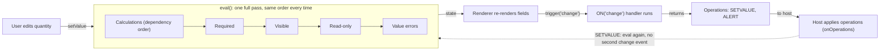

<PageBadges />

import { Callout } from "zudoku/ui/Callout"

The engine does not track which fields a change affects. Whenever something changes, it runs one
full evaluation pass over the whole form, always in the same order. Knowing that order explains
most of what you see at runtime: why a calculated field can drive visibility, why a hidden field
still counts in a calculation, and when event handlers run.

## Creating an engine

`createFormEngine({ schema, initialValues })` prepares the form once. It:

1. Validates the schema and throws if it is invalid. See [Schema validation](/core/schema/validation).
2. Fills in values: the `initialValues` you pass, then each field's `default_value` for everything
   else.
3. Works out which calculated fields depend on which other fields. This happens once, not on every
   evaluation.
4. Runs `form.events.code` once to register event handlers. No event is dispatched at this point.

Creating an engine does not evaluate the form. Visibility, requiredness, and errors stay empty until
the first `engine.eval()`. The official bindings call it immediately after creating the engine.

## One evaluation pass

`engine.eval()` runs these steps in order, every time:

<EngineDiagram name="evaluation-cycle">



</EngineDiagram>

| Step            | What happens                                                                           | Result in state |
| --------------- | -------------------------------------------------------------------------------------- | --------------- |
| 1. Calculations | Every `CalculatedField` runs its `calculate` expression, dependencies first            | `values`        |
| 2. Required     | `required_conditions` is checked, or the static `required` flag is used                | `required`      |
| 3. Visibility   | `visible_conditions` is checked, or the static `visible` flag is used                  | `visible`       |
| 4. Read-only    | `read_only_conditions` is checked, or the static `read_only` flag is used              | `read_only`     |
| 5. Validation   | Each field's value is checked against its own rules, such as `pattern` or number range | `errors`        |

After the pass, `engine.getState()` returns the result. The same values always produce the same
state, no matter in which order the user entered them.

`eval()` also collects calculation diagnostics, such as cycles or expressions that throw. Read them
with `engine.getDiagnostics()`. They do not change `errors`, conditions, or events. See
[Seeing errors and warnings](/core/engine/calculations-dependencies#seeing-errors-and-warnings).

### What the order means for your schema

- **Conditions see calculated values.** Calculations run first, so a `visible_conditions` or
  `required_conditions` can reference a `CalculatedField` and always gets its current value.
- **Calculations ignore visibility.** Hiding a field does not clear its value. A hidden field's
  value is still in `values` and still counts in any calculation that references it.
- **Validation covers every field.** Value errors are computed for hidden fields too. An empty
  required field is not an error in `errors`; the renderer or your application decides whether it
  blocks submission. See [Required fields and submission](/core/schema/validation).
- **Choice conditions compare selected values.** A condition on a choice field compares the selected
  choice `value`, not the whole stored object. See
  [Conditions and operators](/core/schema/conditions-operators).

### Sections follow their children

Visibility is evaluated from the innermost fields outward. A `Section` or `RepeatableSection` whose
children are all hidden is hidden too, whatever its own `visible` or `visible_conditions` say. If at
least one child is visible, the section's own settings apply.

## When a value changes

The engine has no separate "update" step. When a user edits a field, the official bindings:

1. Write the new value into the engine's values.
2. Run `engine.eval()`, which repeats the full pass above.
3. Publish the new state to the UI.
4. Dispatch `change` for the edited field, which runs any matching `ON("change", ...)` handler.

Event handlers never change the form themselves. They return a list of operations, such as
`SETVALUE` or `ALERT`, and the host applies them. When the host applies a `SETVALUE`, it writes the
value and runs `eval()` again, but it does not dispatch another `change` event. A handler therefore
cannot start a chain of change events by setting other fields.

<Callout type="info" title="Event support in the bindings">
  form0-core defines a broader event vocabulary, including record, field, and repeatable-section
  events. The official renderers currently dispatch the portable lifecycle events `load-record`,
  `edit-record`, and `change`. Other events are not dispatched automatically because their timing
  depends on the host application's workflow and UI. Applications can dispatch them explicitly with
  `engine.trigger(...)`. Additional automatic dispatch may be considered individually, but schemas
  should rely only on events documented by their host or binding. See [Event dispatch in official
  bindings](/core/builtins/events-overview).
</Callout>

## Using the engine without a renderer

If you drive the engine yourself, follow the same sequence the bindings use:

```js
import { createFormEngine } from "form0-core"

const engine = createFormEngine({ schema, initialValues: { quantity: 2 } })
engine.eval()

// When the user changes a value:
engine.getState().values.quantity = 3
engine.eval()

// Then dispatch the change event and apply the operations it returns.
const operations = engine.trigger("change", "quantity")
```

<Callout type="caution" title="Choice fields use runtime value shapes">
  `initialValues` and direct writes to `engine.getState().values` must use the engine's live value
  shape. For example, a `SingleChoiceField` or `BooleanField` uses
  `{ "choice": [{ "value": "it", "label": "Italy" }], "other": [] }`, while a
  `MultiChoiceField` uses `choices` instead of `choice`. This differs from a choice field's scalar or
  array `default_value` in the schema. Official renderer field components produce these live shapes;
  form0-core does not currently provide a public value-setting and normalization method.
</Callout>

Your application is responsible for applying the returned operations and for deciding when an
empty required field blocks submission.

## Record-tree preparation

`createRecordEvaluator({ schema, helpers, security })` shares the existing expression executor and
scope rules, and coordinates actual root/child record instances. Hosts use this API to select and
validate one snapshot before persistence, and apply its result through their renderer or controller.
`engine.eval()` retains its existing intrinsic-state behavior.

```js
import { createRecordEvaluator } from "form0-core"

const evaluator = createRecordEvaluator({ schema })
const accepted = await evaluator.evaluate(snapshot)
const refreshed = await evaluator.evaluate(snapshot, { mode: "refresh" })
const prepared = await evaluator.prepareSubmission(snapshot)
```

`snapshot` uses `{ values, repeatable }`. Each row retains its existing `id`, `values`, nested
`repeatable`, attachments and metadata. Values use data_names; repeatable maps use schema keys when
present. Stored choice objects must first be converted to live shape with existing record utilities.
No call mutates the input, persists data, generates record IDs/timestamps or applies a proposal to UI.

Accepted mode keeps closed child calculations and recomputes root aggregates from accepted values.
Saving a child amount from 100 to 150 updates the aggregate when the host supplies that accepted row;
cancelling the edit does not. Refresh mode prepares all child calculations together. With tax changed
from 10% to 20%, accepted child total 110 becomes proposed 120. Validation and output use the same
selected snapshot. Real record-spanning dependency cycles fail without a partial snapshot; local
calculation diagnostics retain their existing separate semantics.

`prepareSubmission` accepts `intent: 'submit' | 'draft'`, `mode: 'automatic' | 'confirm'`,
`allowRetain: true`, and `managedEvents: true` (both flags default false). Automatic is the default;
a host-required confirmation cannot weaken schema confirmation. Changed child values in confirm
mode return `status: 'requires_decision'`, `reviewId`, `proposal`, `changes`, `choices` and
`snapshot: null`. The proposal is for review, not delivery. After an explicit host/user decision,
call again with current inputs, identical policy options and
`decision: { reviewId, action: 'refresh' | 'retain' | 'cancel' }`. Retention requires host permission
on both calls. New preparations, changed inputs/options or another evaluator invalidate the review;
acceptance uses the captured values, and decisions are single-use.

Check `eligible` before delivery. Status is `ready`, `blocked`, `requires_decision`, `failed` or
`cancelled`. `validationSummary`, calculation `diagnostics` and execution `issues` remain separate.
Drafts retain child calculations without a dialog and allow ordinary validation failures. They still
report those failures and pending freshness; execution failures prevent eligibility.

Persist `freshness` separately from the record: `{ version: 1, status: 'current' | 'pending',
schemaRevision, affected: [{ instancePath, fields: [{ fieldName, fieldKey }] }] }`. Restore it for the host's
pending-state UI. Every new preparation recomputes from current inputs; metadata is not a replayable
proposal. Clear stored pending status only after persisting the corresponding current result.

Each affected entry represents one row; `fields` lists its changed calculation identities. Complete
ancestry is stored once per row, preserving ID zero and positional targeting. Current freshness has
an empty affected list.

Handler registration uses each selected scope; parsing and compilation are shared.

Managed preparation runs root and participating closed-row validation only, with current selected
ancestor values. It does not replay closed-row load/edit/save/unload. Hosts keep the existing
validate → save once → conditional re-evaluate/revalidate → serialize sequence. Changed save-hook
inputs invalidate an earlier review without rerunning that hook. `event.isValid` describes built-in
validity of its executing scope; combined tree validity is in the summary.

Evaluation supports `signal`, an 8ms default scheduling target (`budgetMs`) and optional async
`yieldToHost`. Individual expressions remain synchronous and can exceed a scheduling slice. Schema
analysis is shared; no permanent engine per closed row is required. Preview sessions also expose
`runRecord({ snapshot, instancePath })` for explicit tree-aware calculation preview.

## Evaluate one open record

`evaluateScope()` evaluates only the selected record, using supplied current ancestors and accepted
other rows. An empty `instancePath` selects the root. Child paths contain every ancestry segment;
identified rows resolve by ID, including zero. Positional paths refer to the captured ordering.
Invalid paths fail explicitly. The result contains `state`, built-in `validationSummary`, changes,
diagnostics and execution issues, with no additional complete record tree. It does not mutate the
caller, refresh closed rows, run lifecycle events, persist data or generate IDs/timestamps.

```js
const editor = await evaluator.evaluateScope(snapshot, {
  instancePath: [],
  signal,
  budgetMs: 8,
  yieldToHost,
})
if (editor.status === "evaluated") {
  renderEditor(editor.state, editor.validationSummary)
}
```

For example, a project with accepted task costs `[10,20]` and a local surcharge of `5` displays
`35` while editing. Cancelling leaves the parent's accepted aggregate unchanged. Saving the project
accepts those values and updates its parent's aggregate. Whole-record submission still uses
`prepareSubmission()`; intrinsic `engine.eval()` retains its existing scalar contract.

## Accepted-snapshot viewing

Scalar engines accept `mode: 'readonly' | 'edit'` (default `edit`). In readonly, `eval()` computes
conditions and intrinsic validation from supplied values, preserving calculations and not applying
missing schema defaults. The host can call `setMode('edit')`, then `eval()`; `getMode()` reads the
current mode. Switching mode does not replay load, restore older database values or persist work.

For a record tree, use `evaluateScope(snapshot, { interactionMode: 'readonly', instancePath })`.
It returns field state and built-in validation from supplied accepted values without calculations.
Editing is the default. Whole-tree `evaluate()` and `prepareSubmission()` policies are unchanged.
