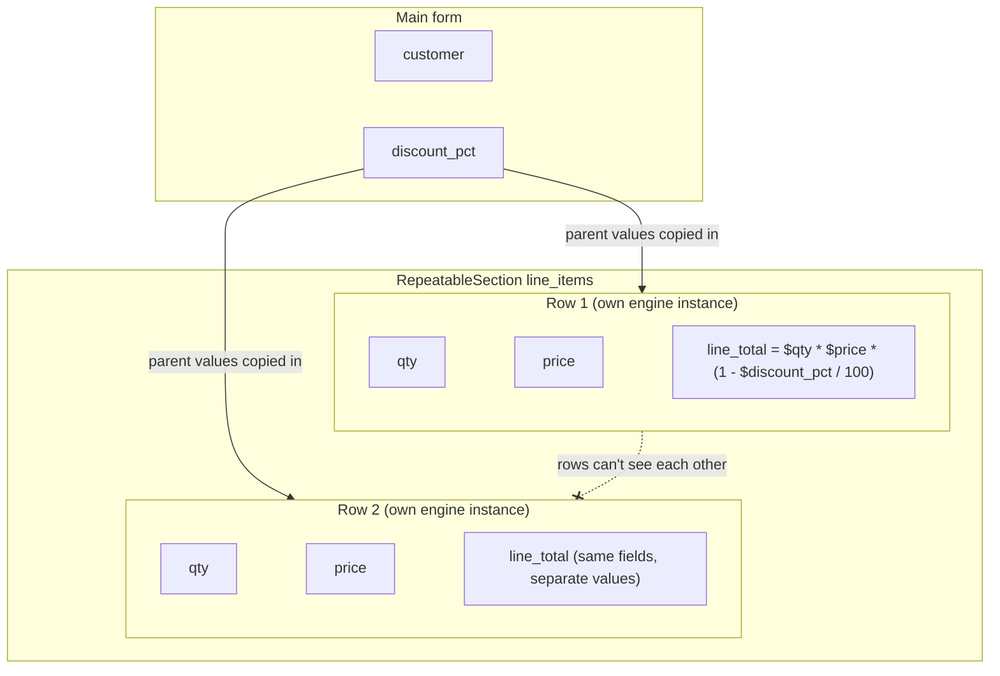

<PageBadges />

A `RepeatableSection` lets a user add any number of rows, such as the line items of an order. Each
row holds its own values for the same set of fields. This page explains how rows are evaluated and
which fields an expression can read from the main form and from a row.

## How rows are evaluated

In the official React and React Native renderers, the main form is evaluated by one engine. Each row
is evaluated in a separate engine instance when it is opened. The row engine uses the same schema
and starts with a copy of the values of everything that contains it, plus the row's own values:

- a row in a top-level `RepeatableSection` gets the main-form values;
- a row in a nested `RepeatableSection` also gets the values of the row that contains it.

Each row then has its own `values`, `visible`, `required`, `read_only`, and `errors`. Two rows never
share state, even though they use the same fields.

If you use `form0-core` without an official renderer, core does not create row engines for you. Your
application is responsible for creating an engine for each row evaluation and supplying the relevant
main-form, ancestor-row, and current-row values.

<EngineDiagram name="repeatable-scope">

</EngineDiagram>

## What an expression can read

Where an expression is defined decides which fields it can read:

| Defined on                 | Main-form fields | Fields in the same row | Fields in rows that contain it | Fields in other rows |
| -------------------------- | ---------------- | ---------------------- | ------------------------------ | -------------------- |
| A main-form field          | Yes              | Not applicable         | Not applicable                 | No                   |
| A field in a top-level row | Yes              | Yes                    | Not applicable                 | No                   |
| A field in a nested row    | Yes              | Yes                    | Yes                            | No                   |

In the order example, `line_total` in each row can use `$discount_pct` from the main form, and
`$qty` and `$price` from its own row. A main-form calculated field cannot read `$line_total`
directly, because each row has its own value.

Calculations and field-event handlers follow these access rules. A calculation reference outside the
allowed fields reads `undefined`, and the engine reports a warning such as
`Field 'line_total' is not accessible from current context`.

Condition scope enforcement described here is for the forthcoming core release addressing #103.
Published core 0.5.1 does not enforce these condition ownership checks.

`visible_conditions`, `required_conditions` and `read_only_conditions` use the same read scopes
shown above: root fields, fields in the current row and fields in ancestor rows. Descendant rows,
sibling branches and unrelated branches are inaccessible. `validateSchema()` and engine construction
reject an illegal reference before opening the form. The error identifies the owning element,
condition property, referenced field and both record ownership paths. Existing field keys and
`data_name` references remain supported.

A `Section` or `BuildingPlanSection` inherits its containing record's ownership. A
`RepeatableSection`'s own conditions govern the collection in its containing record, while its child
fields belong to individual rows. For example, a root `line_items` collection can condition its
visibility on root `customer`, but cannot reference its own row field `qty`. A collection nested
inside a line-item row can reference that row's `qty`.

Every reference in an array, AND or OR rule is checked, even in a branch that would not be evaluated
because another branch already determines the result. Defaults, missing values and `not_equal_to`
do not grant access. A defensive runtime violation throws a configuration error and emits a
structured access warning; it does not become an intrinsic `state.errors` entry or a calculation
diagnostic.

For example, accepted `inspections` scores may be `95` and `90`, while the schema default for
`inspection_score` is `50`. A `payments.approval_note` condition cannot directly compare that unrelated
field with `80`: the schema is rejected instead of using `50 < 80` to require the note. To correct an
existing invalid rule, reference an explicit root or ancestor result, or a local helper calculated
from that permitted result. If your application supplies root `inspection_scores: [95, 90]`, a helper
inside `payments` can calculate `SETRESULT($inspection_scores.some((score) => score < 80));` and the
note can condition on that local helper. No collection builtin or automatic closed-row refresh is
introduced by condition scope enforcement.

## Parent values are a copy

A row reads the parent values that were copied into its engine. The official renderers copy the
current parent values each time a row is opened. Changing a parent value later does not recalculate
the other rows: each keeps the calculated values from when it was last evaluated, until it is opened
again.

## Events and rows

The official React and React Native bindings offer portable record and repeatable lifecycle events
when `engineOptions.events.lifecycle` is enabled. Row handlers receive instance scope; opening a row
does not replay root load handlers. Without that opt-in, legacy dispatch remains available. See
[Event dispatch in official bindings](/core/builtins/events-overview) for timing and metadata.

Record events, such as `load-record`, can read only main-form fields. Field and repeatable event
handlers follow their declared scope; ancestor reads and local-only writes remain unchanged.

## Rows in the output record

When the form is submitted, each row becomes a child record of the main record. See
[Output and records](/core/output-records).

## Explicit collection reads (unreleased)

A named nested RepeatableSection may have many record instances without duplicating its data_name.
For example, one `projects` definition contains one `tasks` definition: P1 has task costs `[10,20]`,
and P2 has `[100]`. At root, `REPEATABLEVALUES($tasks, 'cost')` returns `[10,20,100]`; inside P1 it
returns `[10,20]`. Known ancestor identities anchor collection reads. Unrelated nested branches are
rejected, and the target must belong to the named section's rows. Explicit ancestor-owned collections
can include sibling rows; ordinary scalar reads/writes gain no additional permissions.

Collection membership includes accepted rows even when hidden. Submission validation separately
excludes hidden ancestors. Use a root collection result and a payment-local boolean helper for
inspection-dependent visibility; missing numeric values should be handled explicitly, for example
`$scores.some(score => typeof score === 'number' && score < 80)`.

These collection/record-evaluator interfaces are forthcoming after 0.6.0 and require separate
consumer adoption. Existing condition-scope enforcement remains unchanged.
