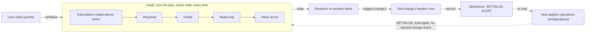

<PageBadges />

import { Callout } from "zudoku/ui/Callout"

El motor no rastrea qué campos se ven afectados por un cambio. Cada vez que algo cambia, ejecuta una
pasada de evaluación completa sobre todo el formulario, siempre en el mismo orden. Conocer ese orden
explica la mayor parte de lo que ves en tiempo de ejecución: por qué un campo calculado puede
controlar la visibilidad, por qué un campo oculto sigue contando en un cálculo y cuándo se ejecutan
los manejadores de eventos.

## Crear un motor

`createFormEngine({ schema, initialValues })` prepara el formulario una sola vez:

1. Valida el esquema y lanza un error si no es válido. Consulta
   [Validación de esquemas](/es/core/schema/validation).
2. Asigna los valores: primero los `initialValues` que pasas y después el `default_value` de cada uno
   de los demás campos.
3. Determina de qué campos depende cada campo calculado. Esto ocurre una sola vez, no en cada
   evaluación.
4. Ejecuta `form.events.code` una vez para registrar los manejadores de eventos. En este momento no
   se despacha ningún evento.

Crear un motor no evalúa el formulario. La visibilidad, la obligatoriedad y los errores siguen vacíos
hasta la primera llamada a `engine.eval()`. Los bindings oficiales la hacen justo después de crear
el motor.

## Una pasada de evaluación

`engine.eval()` ejecuta estos pasos en orden, siempre:

<EngineDiagram name="evaluation-cycle">



</EngineDiagram>

| Paso              | Qué ocurre                                                                                     | Resultado en el estado |
| ----------------- | ---------------------------------------------------------------------------------------------- | ---------------------- |
| 1. Cálculos       | Cada `CalculatedField` ejecuta su expresión `calculate`, primero las dependencias              | `values`               |
| 2. Obligatoriedad | Se comprueba `required_conditions` o se usa el indicador estático `required`                   | `required`             |
| 3. Visibilidad    | Se comprueba `visible_conditions` o se usa el indicador estático `visible`                     | `visible`              |
| 4. Solo lectura   | Se comprueba `read_only_conditions` o se usa el indicador estático `read_only`                 | `read_only`            |
| 5. Validación     | El valor de cada campo se comprueba con sus propias reglas, como `pattern` o el rango numérico | `errors`               |

Después de la pasada, `engine.getState()` devuelve el resultado. Los mismos valores producen siempre
el mismo estado, sin importar el orden en que el usuario los introdujo.

`eval()` también recoge los diagnósticos de los cálculos, como ciclos o expresiones que lanzan un
error. Léelos con `engine.getDiagnostics()`. No modifican `errors`, las condiciones ni los eventos.
Consulta [Ver errores y avisos](/es/core/engine/calculations-dependencies#ver-errores-y-avisos).

### Qué implica el orden para tu esquema

- **Las condiciones ven los valores calculados.** Los cálculos se ejecutan primero, así que un
  `visible_conditions` o un `required_conditions` puede hacer referencia a un `CalculatedField` y
  siempre obtiene su valor actual.
- **Los cálculos ignoran la visibilidad.** Un campo oculto conserva su valor de forma
  predeterminada, así que el valor sigue en `values` y sigue contando en cualquier cálculo que lo
  use. Para borrarlo, consulta
  [Borrar un valor cuando un campo se oculta](/es/core/fields/common-attributes#borrar-un-valor-cuando-un-campo-se-oculta).
- **La validación cubre todos los campos.** Los errores de valor se calculan también para los campos
  ocultos. Un campo obligatorio vacío no es un error en `errors`: el renderer o tu aplicación decide
  si bloquea el envío. Consulta [Campos obligatorios y envío](/es/core/schema/validation).
- **Las condiciones sobre campos de elección comparan los valores seleccionados.** Una condición
  sobre un campo de elección compara el `value` de la opción seleccionada, no todo el objeto
  almacenado. Consulta [Condiciones y operadores](/es/core/schema/conditions-operators).

### Las secciones siguen a sus hijos

La visibilidad se evalúa desde los campos más internos hacia fuera. Una `Section` o una
`RepeatableSection` cuyos hijos están todos ocultos también se oculta, digan lo que digan sus
`visible` o `visible_conditions`. Si al menos un hijo es visible, se aplica la configuración propia
de la sección.

## Cuando cambia un valor

El motor no tiene un paso de "actualización" aparte. Cuando un usuario edita un campo, los bindings
oficiales:

1. Escriben el nuevo valor en los valores del motor.
2. Ejecutan `engine.eval()`, que repite la pasada completa descrita arriba.
3. Publican el nuevo estado en la interfaz.
4. Despachan `change` para el campo editado, lo que ejecuta cualquier manejador
   `ON("change", ...)` que coincida.

Los manejadores de eventos nunca cambian el formulario por sí mismos. Devuelven una lista de
operaciones, como `SETVALUE` o `ALERT`, y el renderer o tu aplicación las aplica. Aplicar un
`SETVALUE` escribe el valor y vuelve a ejecutar `eval()`, pero no despacha otro evento `change`. Por
eso un manejador no puede iniciar una cadena de eventos change al establecer otros campos.

<Callout type="info" title="Eventos en los renderers oficiales">
  Los renderers oficiales despachan eventos de ciclo de vida de forma predeterminada, como
  `load-record` y `save-record`, además de `change`, `focus` y `blur`. Si usas `form0-core`
  directamente, despacha tú los eventos con `engine.trigger(...)`. Consulta [Despacho de eventos en
  los bindings oficiales](/es/core/builtins/events-overview).
</Callout>

## Usar el motor sin un renderer

Si controlas el motor tú mismo, sigue la misma secuencia que usan los bindings:

```js
import { createFormEngine } from "form0-core"

const engine = createFormEngine({ schema, initialValues: { quantity: 2 } })
engine.eval()

// When the user changes a value:
engine.setValue("quantity", 3)

// Then dispatch the change event and apply the operations it returns.
const operations = engine.trigger("change", "quantity")
```

`setValue()` y `setValues()` aceptan valores simples, incluido un identificador de texto para un
campo de opción, y ejecutan la evaluación por ti. Los registros guardados usan otro formato.
Consulta [Actualización y normalización de valores](/es/core/engine/value-updates).

Tu aplicación es responsable de aplicar las operaciones devueltas y de decidir cuándo un campo
obligatorio vacío bloquea el envío.

## Evaluar un registro completo

`engine.eval()` cubre un solo registro. Un formulario con secciones repetibles es un árbol: un
registro principal, sus filas y las filas que haya dentro de ellas. Usa
`createRecordEvaluator({ schema, helpers, security })` cuando necesites un resultado para todo el
árbol, como comprobar un registro antes de guardarlo. Usa las mismas expresiones y reglas de ámbito
que el motor.

```js
import { createRecordEvaluator } from "form0-core"

const evaluator = createRecordEvaluator({ schema })
const accepted = await evaluator.evaluate(snapshot)
const refreshed = await evaluator.evaluate(snapshot, { mode: "refresh" })
const prepared = await evaluator.prepareSubmission(snapshot)
```

`snapshot` tiene la forma `{ values, repeatable }`. Los valores usan `data_name`, y los mapas de
repetibles usan las claves del esquema cuando existen. Cada fila conserva su `id`, `values`,
`repeatable` anidado, adjuntos y metadatos. Para partir de un registro guardado, conviértelo con
[`buildFormRecordSnapshot`](/es/core/output-records#cargar-un-registro-guardado).

Ninguna de estas llamadas cambia `snapshot`, guarda datos, crea identificadores de registro o marcas
de tiempo, ni actualiza un formulario en pantalla.

### Conservar o actualizar las filas guardadas

Una fila guardada almacena sus valores calculados. `evaluate()` te permite elegir qué hacer con
ellos:

- **De forma predeterminada**, las filas guardadas conservan sus valores calculados, y los totales
  del registro principal se obtienen a partir de ellos. Si el importe de una fila pasa de 100 a 150
  y tu aplicación entrega esa fila guardada, el total se actualiza. Si el usuario cancela la
  edición, no.
- **Con `mode: "refresh"`**, todas las filas se recalculan juntas. Si un impuesto pasa del 10% al
  20%, un total guardado de 110 se convierte en 120 en el resultado.

La validación y la salida usan ese mismo resultado. Un ciclo de dependencias que abarca varios
registros falla y no devuelve ningún snapshot. Los diagnósticos de cálculo dentro de un registro se
informan como siempre.

### Preparar un envío

`prepareSubmission(snapshot, options)` produce el snapshot que se guardará, después de los cálculos
y la validación. Comprueba `eligible` antes de guardarlo.

| Opción                 | Valores                    | Predeterminado | Finalidad                                                                                             |
| ---------------------- | -------------------------- | -------------- | ----------------------------------------------------------------------------------------------------- |
| `intent`               | `"submit"`, `"draft"`      | `"submit"`     | Si es un envío final o un borrador.                                                                   |
| `mode`                 | `"automatic"`, `"confirm"` | `"automatic"`  | Si las filas modificadas necesitan una revisión.                                                      |
| `allowRetain`          | Booleano                   | `false`        | Permite que una revisión conserve valores calculados anteriores.                                      |
| `managedEvents`        | Booleano                   | `false`        | Ejecuta los manejadores de validación.                                                                |
| `validateHiddenValues` | Booleano                   | `false`        | [Comprueba los valores ocultos](/es/core/schema/validation#comprobar-valores-ocultos-en-un-servidor). |

`status` es `ready`, `blocked`, `requires_decision`, `failed` o `cancelled`. Los hallazgos de
validación (`validationSummary`), los `diagnostics` de cálculo y los `issues` de ejecución se
informan por separado.

De forma predeterminada, los valores de fila modificados se actualizan automáticamente. Un borrador
(`intent: "draft"`) conserva en cambio los valores calculados guardados de las filas sin revisión, y
puede ser apto con errores de validación. Aun así informa de esos errores y de las filas
desactualizadas. Un manejador que falla lo hace no apto.

### Revisar filas modificadas

Usa una revisión cuando los usuarios deban ver los valores recalculados antes de guardarlos. Pasa
`mode: "confirm"` o define `"repeatable_recalculation": "confirm"` en el formulario.
`mode: "automatic"` no puede desactivar una confirmación definida en el esquema.

Si algún valor de fila cambiaría, `prepareSubmission()` devuelve `status: "requires_decision"`, con
`reviewId`, `proposal`, `changes`, `choices` y `snapshot: null`. Muestra `proposal` al usuario, pero
no lo guardes. Cuando el usuario decida, llama de nuevo a `prepareSubmission()` con las mismas
entradas y opciones, más la decisión:

```js
const prepared = await evaluator.prepareSubmission(snapshot, { mode: "confirm" })

if (prepared.status === "requires_decision") {
  showReview(prepared.proposal, prepared.changes)
}

// After the user decides, with the same evaluator, snapshot, and options:
const result = await evaluator.prepareSubmission(snapshot, {
  mode: "confirm",
  decision: { reviewId: prepared.reviewId, action: "refresh" },
})
```

`action` es `refresh`, `retain` o `cancel`. `retain` conserva los valores calculados anteriores y
necesita `allowRetain: true` en ambas llamadas. Sin él, la llamada falla con
`retention_not_allowed`.

Una revisión termina cuando inicias otra preparación, cambias las entradas o las opciones, o usas
otro evaluador. Una decisión solo funciona una vez y aplica los valores capturados para la revisión.

### Guardar `freshness` con el registro

`freshness` indica si los cálculos guardados de un registro están al día. Un registro queda
`pending` cuando el usuario conservó valores anteriores o guardó un borrador:

```js
{
  version: 1,
  status: "pending", // or "current"
  schemaRevision: "form0-bffe7ba2caa7302e",
  affected: [{ instancePath, fields: [{ fieldName, fieldKey }] }],
}
```

Guárdalo junto al registro, no dentro de él, y restáuralo para que tu aplicación pueda mostrar qué
filas están desactualizadas. Borra un estado `pending` guardado solo después de guardar el resultado
actual correspondiente. Cada preparación parte de las entradas actuales, así que un `freshness`
guardado no puede repetir una propuesta antigua.

Cada entrada de `affected` es una fila, y `fields` enumera los campos calculados que cambiaron en
ella. `instancePath` es la ruta completa a la fila, lo que mantiene exactos el identificador cero y
las filas por posición. Cuando `status` es `current`, `affected` está vacío.

### Manejadores de validación en un envío

Con `managedEvents: true`, `prepareSubmission()` ejecuta los manejadores de validación del registro
principal y de las filas cerradas, con los valores actuales de sus padres. No repite los eventos de
carga, edición, guardado o descarga de las filas cerradas. `event.isValid` describe solo el registro
en el que se ejecuta el manejador. El resultado de todo el árbol está en `validationSummary`.

Si tu aplicación ejecuta ella misma los manejadores de guardado, mantén este orden: validar,
ejecutar el manejador de guardado una vez, evaluar y validar de nuevo si cambió valores, y después
construir el registro. Un manejador de guardado que cambia las entradas termina una revisión
anterior, y no vuelve a ejecutarse.

### Evaluaciones largas

Los árboles grandes pueden tardar. Pasa `signal` para cancelar una evaluación, `budgetMs` para fijar
un objetivo por cada tramo de trabajo (8 ms de forma predeterminada) y `yieldToHost`, una función
asíncrona que permite que tu interfaz responda entre tramos. Una expresión siempre se ejecuta hasta
el final, así que puede superar ese objetivo. Las filas comparten un único análisis del esquema, así
que no necesitas un motor por cada fila cerrada.

Las sesiones de vista previa también ofrecen `runRecord({ snapshot, instancePath })` para
previsualizar los cálculos en todo el árbol.

## Evaluar un registro abierto

Usa `evaluateScope()` mientras un usuario edita un registro, como una fila abierta. Evalúa solo ese
registro, con los valores actuales de sus padres y los valores guardados de las demás filas:

```js
const editor = await evaluator.evaluateScope(snapshot, {
  instancePath: [],
  signal,
  budgetMs: 8,
  yieldToHost,
})
if (editor.status === "evaluated") {
  renderEditor(editor.state, editor.validationSummary)
}
```

Un `instancePath` vacío selecciona el registro principal. La ruta de una fila tiene un segmento por
cada nivel de anidamiento. Una fila con identificador se localiza por ese identificador, incluido el
cero, y una fila sin él se localiza por su posición en el snapshot. Una ruta no válida falla con un
error.

El resultado contiene `state`, el `validationSummary` integrado, los cambios, los diagnósticos y los
problemas de ejecución, pero no un árbol completo. La llamada no cambia tu entrada, no actualiza las
filas cerradas, no ejecuta eventos de ciclo de vida, no guarda datos ni crea identificadores o
marcas de tiempo.

Por ejemplo, un proyecto con costes de tarea guardados `[10,20]` y un recargo local de `5` muestra
`35` mientras el usuario lo edita. Cancelar deja sin cambios el total guardado en el padre. Guardar
el proyecto conserva esos valores y actualiza el total del padre. Para enviar un registro completo,
usa `prepareSubmission()`.

## Ver un registro sin editarlo

Para mostrar un registro guardado, crea el motor con `mode: "readonly"`. `eval()` obtiene entonces
las condiciones y la validación a partir de los valores que aportas, mantiene los valores calculados
tal como están y no aplica los valores predeterminados que falten. El modo predeterminado es
`"edit"`.

Para permitir la edición, llama a `setMode("edit")` y después a `eval()`. `getMode()` devuelve el
modo actual. Cambiar de modo no vuelve a ejecutar los eventos de carga, no restaura valores
anteriores de la base de datos ni guarda nada.

Para un árbol de registros, usa
`evaluateScope(snapshot, { interactionMode: "readonly", instancePath })`. Devuelve el estado de los
campos y la validación integrada a partir de los valores que aportas, sin cálculos.

## Borrar valores ocultos

Si un campo define
[`visible_preserve_value`](/es/core/fields/common-attributes#borrar-un-valor-cuando-un-campo-se-oculta)
como `false`, la evaluación lo borra cuando se oculta. Borrar un valor puede cambiar cálculos y
condiciones, que a su vez pueden ocultar más campos, así que la evaluación se repite hasta que nada
cambia. Esto no ejecuta eventos `change` ni de ciclo de vida. Los esquemas que no usan el atributo
omiten este paso.

`evaluate()`, `evaluateScope()` y `prepareSubmission()` enumeran lo que han borrado en
`clearedFields`:

```js
;[{ instancePath: [], fieldName: "email", fieldKey: "email" }]
```

Las entradas nunca contienen el valor anterior. Si mantienes tú el estado del formulario, borra los
campos indicados, incluidos los de las filas que no estás mostrando. Tu `snapshot` no cambia, y una
evaluación de solo lectura no borra nada. Borrar no influye en si las filas guardadas conservan o
actualizan sus valores calculados.

## Resolver un valor oculto que no pasa la validación

Cuando pasas `validateHiddenValues`, `prepareSubmission()` y `validateSubmission()` marcan cada
valor oculto que no cumple sus propias reglas con `hidden: true`. Para reemplazar o borrar uno de
esos valores desde tu código, primero inspecciónalo y después corrígelo:

```js
const finding = { fieldName: "hidden_note", instancePath: [] }
const inspected = await evaluator.inspectHiddenValue(snapshot, finding)

if (inspected.status === "inspected") {
  // inspected.value holds the current value. Decide what to do with it.
  const corrected = await evaluator.correctHiddenValue(snapshot, { ...finding, value: null })

  if (corrected.status === "evaluated") {
    // Use corrected.snapshot, unless the record changed since you inspected it.
  }
}
```

- `inspectHiddenValue()` comprueba que el valor sigue oculto y sigue sin cumplir sus reglas.
  Devuelve una copia en `value`.
- `correctHiddenValue()` acepta un reemplazo que cumpla las reglas propias del campo, o `null` para
  borrar el valor. Devuelve el registro actualizado en `snapshot` y el resultado de las
  comprobaciones en `validationSummary`.

Ninguno de los dos métodos cambia tu `snapshot`, muestra el campo, ejecuta manejadores de `change` o
de ciclo de vida, elimina filas ni guarda nada. Las filas guardadas conservan sus valores
calculados, igual que con `evaluate()`.

Si algo falla, `status` es `"failed"` e `issues` incluye uno de estos códigos:

- `hidden_value_not_invalid`: el valor ya no falla o el campo ya no está oculto.
- `invalid_replacement`: el reemplazo no cumple las reglas propias del campo.
- `readonly_scope`: pasaste `interactionMode: "readonly"`.

Asegúrate de que el registro no haya cambiado antes de usar `corrected.snapshot`. Los bindings y la
vista previa de la CLI lo hacen por ti, y piden cerrar antes cualquier fila abierta.

Las filas guardadas explícitamente permanecen en el registro enviado aunque todas sus respuestas estén vacías. Conservan sus identificadores y metadatos, y las respuestas vacías de TextField/NumericField se serializan como `null`. Ambos serializadores estructurados aplican esta regla sin ninguna opción. Cancela una fila sin guardar o elimina una fila guardada para excluirla.
