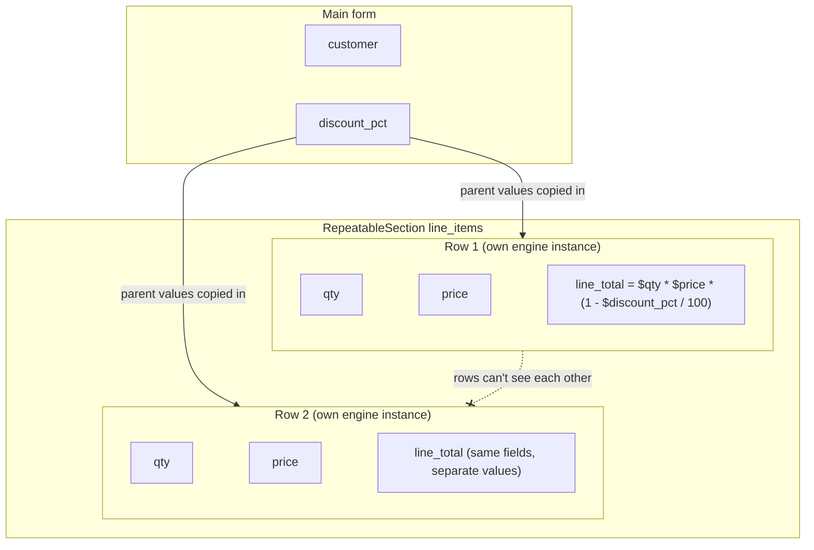

<PageBadges />

Una `RepeatableSection` permite al usuario añadir cualquier número de filas, como las líneas de un
pedido. Cada fila guarda sus propios valores para el mismo conjunto de campos. Esta página explica
cómo se evalúan las filas y qué campos puede leer una expresión del formulario principal y de una
fila.

## Cómo se evalúan las filas

En los renderers oficiales de React y React Native, un motor evalúa el formulario principal. Cada
fila se evalúa en una instancia de motor distinta cuando se abre. El motor de la fila usa el mismo
esquema y parte de una copia de los valores de todo lo que la contiene, más los valores propios de
la fila:

- una fila de una `RepeatableSection` de primer nivel recibe los valores del formulario principal;
- una fila de una `RepeatableSection` anidada recibe también los valores de la fila que la contiene.

Cada fila tiene entonces sus propios `values`, `visible`, `required`, `read_only` y `errors`. Dos
filas nunca comparten estado, aunque usen los mismos campos.

Si usas `form0-core` sin un renderer oficial, el core no crea los motores de las filas por ti. Tu
aplicación es responsable de crear un motor para cada evaluación de fila y de proporcionar los
valores correspondientes del formulario principal, de las filas antecesoras y de la fila actual.

<EngineDiagram name="repeatable-scope">

</EngineDiagram>

## Qué puede leer una expresión

El lugar donde se define una expresión decide qué campos puede leer:

| Definida en                          | Campos del formulario principal | Campos de la misma fila | Campos de las filas que la contienen | Campos de otras filas |
| ------------------------------------ | ------------------------------- | ----------------------- | ------------------------------------ | --------------------- |
| Un campo del formulario principal    | Sí                              | No aplica               | No aplica                            | No                    |
| Un campo de una fila de primer nivel | Sí                              | Sí                      | No aplica                            | No                    |
| Un campo de una fila anidada         | Sí                              | Sí                      | Sí                                   | No                    |

En el ejemplo del pedido, `line_total` de cada fila puede usar `$discount_pct` del formulario
principal y `$qty` y `$price` de su propia fila. Un campo calculado del formulario principal no puede
leer `$line_total` directamente, porque cada fila tiene su propio valor.

Los cálculos y los manejadores de eventos de campo siguen estas reglas de acceso. Una referencia de
un cálculo fuera de los campos permitidos lee `undefined`, y el motor emite un aviso como
`Field 'line_total' is not accessible from current context`.

La aplicación de ámbitos en condiciones descrita aquí corresponde a la próxima versión de core
que aborda #103. La versión publicada 0.5.1 todavía no aplica estas comprobaciones de pertenencia.

`visible_conditions`, `required_conditions` y `read_only_conditions` usan los mismos ámbitos de
lectura de la tabla anterior: campos raíz, de la fila actual y de las filas antecesoras. No permiten
leer filas descendientes, ramas hermanas ni ramas ajenas. `validateSchema()` y la creación del motor
rechazan una referencia ilegal antes de abrir el formulario. El error identifica el elemento dueño,
la propiedad de condición, el campo referenciado y ambas rutas de pertenencia a registros. Se mantiene
el soporte de claves de campo y referencias por `data_name`.

Una `Section` o `BuildingPlanSection` hereda la pertenencia del registro que la contiene. Las
condiciones de una `RepeatableSection` gobiernan la colección en el registro que la contiene; sus
campos hijos pertenecen a filas individuales. Por ejemplo, la colección raíz `line_items` puede
condicionar su visibilidad al campo raíz `customer`, pero no a su propio campo de fila `qty`. Una
colección anidada dentro de una fila de pedido sí puede leer el `qty` de esa fila.

Se comprueba cada referencia en reglas de tipo array, AND u OR, incluso en una rama que no se
evaluaría porque otra ya determina el resultado. Los valores predeterminados, ausentes y
`not_equal_to` no conceden acceso. Una infracción detectada defensivamente durante la ejecución lanza
un error de configuración y emite un aviso estructurado de acceso; no se convierte en un error
intrínseco de `state.errors` ni en un diagnóstico de cálculo.

Por ejemplo, las puntuaciones aceptadas en `inspections` pueden ser `95` y `90`, mientras que el
valor predeterminado de `inspection_score` es `50`. Una condición de `payments.approval_note` no puede
comparar directamente ese campo ajeno con `80`: se rechaza el esquema en vez de usar `50 < 80` para
exigir la nota. Para corregir una regla inválida existente, referencia un resultado explícito raíz o
antecesor, o un cálculo auxiliar local basado en ese resultado permitido. Si tu aplicación proporciona
`inspection_scores: [95, 90]` en la raíz, un auxiliar dentro de `payments` puede calcular
`SETRESULT($inspection_scores.some((score) => score < 80));` y la nota puede condicionar su estado a
ese auxiliar local. La aplicación de ámbitos en condiciones no introduce funciones de colección ni
actualización automática de filas cerradas.

## Los valores del padre son una copia

Una fila lee los valores del padre que se copiaron en su motor. Los renderers oficiales copian los
valores actuales del padre cada vez que se abre una fila. Cambiar después un valor del padre no
recalcula las demás filas: cada una conserva los valores calculados de su última evaluación hasta que
se vuelve a abrir.

## Eventos y filas

Los bindings oficiales de React y React Native ofrecen eventos portables del ciclo de vida de
registros y repetibles al activar `engineOptions.events.lifecycle`. Los manejadores de fila reciben
el ámbito de la instancia; abrir una fila no repite los manejadores de carga raíz. Sin esa activación,
se mantiene el despacho heredado. Consulta
[Despacho de eventos en los bindings oficiales](/es/core/builtins/events-overview) para conocer los
momentos y los metadatos.

Los eventos de registro, como `load-record`, solo pueden leer campos raíz. Los manejadores de eventos
de campo y repetibles siguen su ámbito declarado; se mantienen las lecturas de antecesores y las
escrituras exclusivamente locales.

## Las filas en el registro de salida

Al enviar el formulario, cada fila se convierte en un registro hijo del registro principal. Consulta
[Salida y registros](/es/core/output-records).
