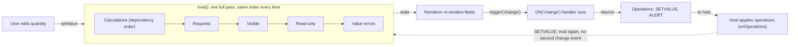

<PageBadges />

import { Callout } from "zudoku/ui/Callout"

Le moteur ne suit pas les champs concernés par une modification. Chaque fois que quelque chose
change, il exécute une passe d'évaluation complète sur tout le formulaire, toujours dans le même
ordre. Connaître cet ordre explique l'essentiel de ce que vous observez à l'exécution : pourquoi un
champ calculé peut piloter la visibilité, pourquoi un champ masqué compte toujours dans un calcul et
quand les gestionnaires d'événements s'exécutent.

## Créer un moteur

`createFormEngine({ schema, initialValues })` prépare le formulaire une seule fois :

1. Il valide le schéma et lève une erreur s'il n'est pas valide. Voir
   [Validation du schéma](/fr/core/schema/validation).
2. Il renseigne les valeurs : d'abord les `initialValues` que vous passez, puis le `default_value`
   de chacun des autres champs.
3. Il détermine de quels champs dépend chaque champ calculé. Cela se fait une seule fois, et non à
   chaque évaluation.
4. Il exécute `form.events.code` une fois pour enregistrer les gestionnaires d'événements. Aucun
   événement n'est déclenché à ce stade.

Créer un moteur n'évalue pas le formulaire. La visibilité, le caractère obligatoire et les erreurs
restent vides jusqu'au premier appel à `engine.eval()`. Les bindings officiels l'appellent juste
après avoir créé le moteur.

## Une passe d'évaluation

`engine.eval()` exécute ces étapes dans l'ordre, à chaque fois :

<EngineDiagram name="evaluation-cycle">



</EngineDiagram>

| Étape               | Ce qui se passe                                                                                         | Résultat dans l'état |
| ------------------- | ------------------------------------------------------------------------------------------------------- | -------------------- |
| 1. Calculs          | Chaque `CalculatedField` exécute son expression `calculate`, dépendances d'abord                        | `values`             |
| 2. Caractère requis | `required_conditions` est vérifié, sinon l'indicateur statique `required` est utilisé                   | `required`           |
| 3. Visibilité       | `visible_conditions` est vérifié, sinon l'indicateur statique `visible` est utilisé                     | `visible`            |
| 4. Lecture seule    | `read_only_conditions` est vérifié, sinon l'indicateur statique `read_only` est utilisé                 | `read_only`          |
| 5. Validation       | La valeur de chaque champ est vérifiée selon ses propres règles, comme `pattern` ou une plage numérique | `errors`             |

Après la passe, `engine.getState()` renvoie le résultat. Les mêmes valeurs produisent toujours le
même état, quel que soit l'ordre dans lequel l'utilisateur les a saisies.

`eval()` collecte aussi les diagnostics des calculs, comme les cycles ou les expressions qui lèvent
une erreur. Lisez-les avec `engine.getDiagnostics()`. Ils ne modifient ni `errors`, ni les
conditions, ni les événements. Consultez
[Voir les erreurs et les avertissements](/fr/core/engine/calculations-dependencies#voir-les-erreurs-et-les-avertissements).

### Ce que l'ordre implique pour votre schéma

- **Les conditions voient les valeurs calculées.** Les calculs s'exécutent en premier : un
  `visible_conditions` ou un `required_conditions` peut donc référencer un `CalculatedField` et
  obtient toujours sa valeur actuelle.
- **Les calculs ignorent la visibilité.** Par défaut, un champ masqué conserve sa valeur : elle
  reste donc dans `values` et compte toujours dans tout calcul qui la référence. Pour l’effacer,
  consultez
  [Effacer une valeur lorsqu’un champ est masqué](/fr/core/fields/common-attributes#effacer-une-valeur-lorsquun-champ-est-masqué).
- **La validation couvre tous les champs.** Les erreurs de valeur sont aussi calculées pour les
  champs masqués. Un champ obligatoire vide n'est pas une erreur dans `errors` : c'est le renderer ou
  votre application qui décide s'il bloque la soumission. Voir
  [Champs obligatoires et soumission](/fr/core/schema/validation).
- **Les conditions sur les champs à choix comparent les valeurs sélectionnées.** Une condition sur
  un champ à choix compare la `value` du choix sélectionné, et non l'objet stocké en entier. Voir
  [Conditions et opérateurs](/fr/core/schema/conditions-operators).

### Les sections suivent leurs enfants

La visibilité est évaluée des champs les plus internes vers l'extérieur. Une `Section` ou une
`RepeatableSection` dont tous les enfants sont masqués est elle aussi masquée, quels que soient ses
`visible` ou `visible_conditions`. Si au moins un enfant est visible, les réglages propres à la
section s'appliquent.

## Quand une valeur change

Le moteur n'a pas d'étape de « mise à jour » distincte. Quand un utilisateur modifie un champ, les
bindings officiels :

1. Écrivent la nouvelle valeur dans les valeurs du moteur.
2. Exécutent `engine.eval()`, qui répète la passe complète décrite ci-dessus.
3. Publient le nouvel état dans l'interface.
4. Déclenchent `change` pour le champ modifié, ce qui exécute tout gestionnaire
   `ON("change", ...)` correspondant.

Les gestionnaires d’événements ne modifient jamais le formulaire eux-mêmes. Ils renvoient une liste
d’opérations, comme `SETVALUE` ou `ALERT`, et le renderer ou votre application les applique.
Appliquer un `SETVALUE` écrit la valeur et relance `eval()`, mais ne déclenche pas d’autre événement
`change`. Un gestionnaire ne peut donc pas lancer une chaîne d’événements change en définissant
d’autres champs.

<Callout type="info" title="Les événements dans les renderers officiels">
  Les renderers officiels déclenchent par défaut les événements de cycle de vie, comme `load-record`
  et `save-record`, ainsi que `change`, `focus` et `blur`. Si vous utilisez `form0-core`
  directement, déclenchez vous-même les événements avec `engine.trigger(...)`. Consultez
  [Déclenchement des événements dans les bindings officiels](/fr/core/builtins/events-overview).
</Callout>

## Utiliser le moteur sans renderer

Si vous pilotez le moteur vous-même, suivez la même séquence que les bindings :

```js
import { createFormEngine } from "form0-core"

const engine = createFormEngine({ schema, initialValues: { quantity: 2 } })
engine.eval()

// When the user changes a value:
engine.setValue("quantity", 3)

// Then dispatch the change event and apply the operations it returns.
const operations = engine.trigger("change", "quantity")
```

`setValue()` et `setValues()` acceptent des valeurs simples, y compris un identifiant textuel pour
un champ de choix, et lancent l’évaluation à votre place. Les enregistrements stockés utilisent un
autre format. Consultez [Mise à jour et normalisation des valeurs](/fr/core/engine/value-updates).

Votre application doit appliquer les opérations renvoyées et décider quand un champ obligatoire vide
bloque la soumission.

## Évaluer un enregistrement complet

`engine.eval()` couvre un seul enregistrement. Un formulaire avec des sections répétables est un
arbre : un enregistrement principal, ses lignes et les lignes qu’elles contiennent. Utilisez
`createRecordEvaluator({ schema, helpers, security })` lorsque vous avez besoin d’un résultat pour
tout l’arbre, par exemple pour vérifier un enregistrement avant de le sauvegarder. Il utilise les
mêmes expressions et règles de portée que le moteur.

```js
import { createRecordEvaluator } from "form0-core"

const evaluator = createRecordEvaluator({ schema })
const accepted = await evaluator.evaluate(snapshot)
const refreshed = await evaluator.evaluate(snapshot, { mode: "refresh" })
const prepared = await evaluator.prepareSubmission(snapshot)
```

`snapshot` a la forme `{ values, repeatable }`. Les valeurs utilisent les `data_name`, et les tables
de répétables utilisent les clés du schéma lorsqu’elles existent. Chaque ligne conserve son `id`,
ses `values`, son `repeatable` imbriqué, ses pièces jointes et ses métadonnées. Pour partir d’un
enregistrement stocké, convertissez-le avec
[`buildFormRecordSnapshot`](/fr/core/output-records#charger-un-enregistrement-stocké).

Aucun de ces appels ne modifie `snapshot`, ne sauvegarde de données, ne crée d’identifiants
d’enregistrement ou d’horodatages, et ne met à jour un formulaire à l’écran.

### Conserver ou actualiser les lignes sauvegardées

Une ligne sauvegardée stocke ses valeurs calculées. `evaluate()` vous permet de choisir quoi en
faire :

- **Par défaut**, les lignes sauvegardées conservent leurs valeurs calculées, et les totaux de
  l’enregistrement principal sont obtenus à partir d’elles. Si le montant d’une ligne passe de 100 à
  150 et que votre application fournit cette ligne sauvegardée, le total est mis à jour. Si
  l’utilisateur annule la modification, il ne l’est pas.
- **Avec `mode: "refresh"`**, toutes les lignes sont recalculées ensemble. Si un taux de taxe passe
  de 10 % à 20 %, un total sauvegardé de 110 devient 120 dans le résultat.

La validation et la sortie utilisent ce même résultat. Un cycle de dépendances qui s’étend sur
plusieurs enregistrements échoue et ne renvoie aucun snapshot. Les diagnostics de calcul au sein
d’un enregistrement sont signalés comme d’habitude.

### Préparer une soumission

`prepareSubmission(snapshot, options)` produit le snapshot à sauvegarder, après les calculs et la
validation. Vérifiez `eligible` avant de le sauvegarder.

| Option                 | Valeurs                    | Par défaut    | Rôle                                                                                                     |
| ---------------------- | -------------------------- | ------------- | -------------------------------------------------------------------------------------------------------- |
| `intent`               | `"submit"`, `"draft"`      | `"submit"`    | Indique s’il s’agit d’une soumission finale ou d’un brouillon.                                           |
| `mode`                 | `"automatic"`, `"confirm"` | `"automatic"` | Indique si les lignes modifiées exigent une revue.                                                       |
| `allowRetain`          | Booléen                    | `false`       | Permet à une revue de conserver d’anciennes valeurs calculées.                                           |
| `managedEvents`        | Booléen                    | `false`       | Exécute les gestionnaires de validation.                                                                 |
| `validateHiddenValues` | Booléen                    | `false`       | [Vérifie les valeurs masquées](/fr/core/schema/validation#vérifier-les-valeurs-masquées-sur-un-serveur). |

`status` vaut `ready`, `blocked`, `requires_decision`, `failed` ou `cancelled`. Les constats de
validation (`validationSummary`), les `diagnostics` de calcul et les `issues` d’exécution sont
signalés séparément.

Par défaut, les valeurs de ligne modifiées sont actualisées automatiquement. Un brouillon
(`intent: "draft"`) conserve au contraire les valeurs calculées sauvegardées des lignes sans revue,
et il peut être admissible avec des erreurs de validation. Il signale quand même ces erreurs et les
lignes qui ne sont plus à jour. Un gestionnaire qui échoue le rend non admissible.

### Examiner les lignes modifiées

Utilisez une revue lorsque les utilisateurs doivent voir les valeurs recalculées avant leur
sauvegarde. Passez `mode: "confirm"` ou définissez `"repeatable_recalculation": "confirm"` dans le
formulaire. `mode: "automatic"` ne peut pas désactiver une confirmation définie dans le schéma.

Si une valeur de ligne devait changer, `prepareSubmission()` renvoie `status: "requires_decision"`,
avec `reviewId`, `proposal`, `changes`, `choices` et `snapshot: null`. Montrez `proposal` à
l’utilisateur, mais ne le sauvegardez pas. Une fois la décision prise, appelez de nouveau
`prepareSubmission()` avec les mêmes entrées et options, plus la décision :

```js
const prepared = await evaluator.prepareSubmission(snapshot, { mode: "confirm" })

if (prepared.status === "requires_decision") {
  showReview(prepared.proposal, prepared.changes)
}

// After the user decides, with the same evaluator, snapshot, and options:
const result = await evaluator.prepareSubmission(snapshot, {
  mode: "confirm",
  decision: { reviewId: prepared.reviewId, action: "refresh" },
})
```

`action` vaut `refresh`, `retain` ou `cancel`. `retain` conserve les anciennes valeurs calculées et
exige `allowRetain: true` lors des deux appels. Sans cela, l’appel échoue avec
`retention_not_allowed`.

Une revue prend fin lorsque vous lancez une autre préparation, modifiez les entrées ou les options,
ou utilisez un autre évaluateur. Une décision ne fonctionne qu’une fois et applique les valeurs
capturées pour la revue.

### Sauvegarder `freshness` avec l’enregistrement

`freshness` indique si les calculs stockés d’un enregistrement sont à jour. Un enregistrement est
`pending` lorsque l’utilisateur a conservé d’anciennes valeurs ou sauvegardé un brouillon :

```js
{
  version: 1,
  status: "pending", // or "current"
  schemaRevision: "form0-bffe7ba2caa7302e",
  affected: [{ instancePath, fields: [{ fieldName, fieldKey }] }],
}
```

Sauvegardez-le à côté de l’enregistrement, pas à l’intérieur, et restaurez-le pour que votre
application puisse montrer quelles lignes ne sont plus à jour. N’effacez un statut `pending` stocké
qu’après avoir sauvegardé le résultat actuel correspondant. Chaque préparation part des entrées
actuelles : un `freshness` stocké ne peut donc pas rejouer une ancienne proposition.

Chaque entrée de `affected` correspond à une ligne, et `fields` liste les champs calculés qui y ont
changé. `instancePath` est le chemin complet vers la ligne, ce qui garde exacts l’identifiant zéro
et les lignes par position. Lorsque `status` vaut `current`, `affected` est vide.

### Gestionnaires de validation dans une soumission

Avec `managedEvents: true`, `prepareSubmission()` exécute les gestionnaires de validation de
l’enregistrement principal et des lignes fermées, avec les valeurs actuelles de leurs parents. Elle
ne rejoue pas les événements de chargement, de modification, de sauvegarde ou de déchargement des
lignes fermées. `event.isValid` décrit seulement l’enregistrement dans lequel le gestionnaire
s’exécute. Le résultat de tout l’arbre se trouve dans `validationSummary`.

Si votre application exécute elle-même les gestionnaires de sauvegarde, gardez cet ordre : valider,
exécuter le gestionnaire de sauvegarde une fois, évaluer et valider de nouveau s’il a modifié des
valeurs, puis construire l’enregistrement. Un gestionnaire de sauvegarde qui modifie les entrées met
fin à une revue antérieure, et il ne s’exécute pas de nouveau.

### Évaluations longues

Les grands arbres peuvent prendre du temps. Passez `signal` pour annuler une évaluation, `budgetMs`
pour fixer un objectif pour chaque tranche de travail (8 ms par défaut) et `yieldToHost`, une
fonction asynchrone qui laisse votre interface répondre entre les tranches. Une expression s’exécute
toujours jusqu’au bout : elle peut donc dépasser cet objectif. Les lignes partagent une seule
analyse du schéma : vous n’avez donc pas besoin d’un moteur par ligne fermée.

Les sessions d’aperçu offrent aussi `runRecord({ snapshot, instancePath })` pour prévisualiser les
calculs dans tout l’arbre.

## Évaluer un enregistrement ouvert

Utilisez `evaluateScope()` pendant qu’un utilisateur modifie un enregistrement, comme une ligne
ouverte. Elle évalue seulement cet enregistrement, avec les valeurs actuelles de ses parents et les
valeurs sauvegardées des autres lignes :

```js
const editor = await evaluator.evaluateScope(snapshot, {
  instancePath: [],
  signal,
  budgetMs: 8,
  yieldToHost,
})
if (editor.status === "evaluated") {
  renderEditor(editor.state, editor.validationSummary)
}
```

Un `instancePath` vide sélectionne l’enregistrement principal. Le chemin d’une ligne comporte un
segment par niveau d’imbrication. Une ligne avec un identifiant est trouvée par cet identifiant, y
compris zéro, et une ligne sans identifiant est trouvée par sa position dans le snapshot. Un chemin
non valide échoue avec une erreur.

Le résultat contient `state`, le `validationSummary` intégré, les changements, les diagnostics et
les problèmes d’exécution, mais pas un arbre complet. L’appel ne modifie pas votre entrée,
n’actualise pas les lignes fermées, n’exécute pas d’événements de cycle de vie, ne sauvegarde pas de
données et ne crée ni identifiants ni horodatages.

Par exemple, un projet avec des coûts de tâches sauvegardés `[10,20]` et une majoration locale de
`5` affiche `35` pendant que l’utilisateur le modifie. Annuler laisse inchangé le total sauvegardé
dans le parent. Sauvegarder le projet conserve ces valeurs et met à jour le total du parent. Pour
soumettre un enregistrement complet, utilisez `prepareSubmission()`.

## Afficher un enregistrement sans le modifier

Pour afficher un enregistrement sauvegardé, créez le moteur avec `mode: "readonly"`. `eval()`
calcule alors les conditions et la validation à partir des valeurs fournies, garde les valeurs
calculées telles quelles et n’applique pas les valeurs par défaut manquantes. Le mode par défaut est
`"edit"`.

Pour permettre la modification, appelez `setMode("edit")` puis `eval()`. `getMode()` renvoie le mode
actuel. Changer de mode ne relance pas les événements de chargement, ne restaure pas d’anciennes
valeurs de la base de données et ne sauvegarde rien.

Pour un arbre d’enregistrements, utilisez
`evaluateScope(snapshot, { interactionMode: "readonly", instancePath })`. Elle renvoie l’état des
champs et la validation intégrée à partir des valeurs fournies, sans calculs.

## Effacer les valeurs masquées

Si un champ définit
[`visible_preserve_value`](/fr/core/fields/common-attributes#effacer-une-valeur-lorsquun-champ-est-masqué)
sur `false`, l’évaluation l’efface lorsqu’il est masqué. Effacer une valeur peut modifier des
calculs et des conditions, qui peuvent masquer d’autres champs : l’évaluation se répète donc jusqu’à
ce que plus rien ne change. Cela n’exécute aucun événement `change` ni événement de cycle de vie.
Les schémas qui n’utilisent pas l’attribut sautent cette étape.

`evaluate()`, `evaluateScope()` et `prepareSubmission()` listent ce qu’elles ont effacé dans
`clearedFields` :

```js
;[{ instancePath: [], fieldName: "email", fieldKey: "email" }]
```

Les entrées ne contiennent jamais l’ancienne valeur. Si vous gérez vous-même l’état du formulaire,
effacez les champs listés, y compris ceux des lignes que vous n’affichez pas. Votre `snapshot` ne
change pas, et une évaluation en lecture seule n’efface rien. L’effacement n’a aucun effet sur le
fait que les lignes sauvegardées conservent ou actualisent leurs valeurs calculées.

## Résoudre une valeur masquée qui échoue à la validation

Lorsque vous passez `validateHiddenValues`, `prepareSubmission()` et `validateSubmission()` marquent
chaque valeur masquée qui ne respecte pas ses propres règles avec `hidden: true`. Pour remplacer ou
effacer l’une de ces valeurs depuis votre code, inspectez-la d’abord, puis corrigez-la :

```js
const finding = { fieldName: "hidden_note", instancePath: [] }
const inspected = await evaluator.inspectHiddenValue(snapshot, finding)

if (inspected.status === "inspected") {
  // inspected.value holds the current value. Decide what to do with it.
  const corrected = await evaluator.correctHiddenValue(snapshot, { ...finding, value: null })

  if (corrected.status === "evaluated") {
    // Use corrected.snapshot, unless the record changed since you inspected it.
  }
}
```

- `inspectHiddenValue()` vérifie que la valeur est toujours masquée et qu’elle échoue toujours. Elle
  renvoie une copie dans `value`.
- `correctHiddenValue()` accepte un remplacement qui respecte les règles propres au champ, ou `null`
  pour effacer la valeur. Elle renvoie l’enregistrement mis à jour dans `snapshot` et le résultat
  des vérifications dans `validationSummary`.

Aucune de ces méthodes ne modifie votre `snapshot`, n’affiche le champ, n’exécute de gestionnaire
`change` ou de cycle de vie, ne supprime de ligne ni ne sauvegarde quoi que ce soit. Les lignes
sauvegardées gardent leurs valeurs calculées, comme avec `evaluate()`.

En cas d’échec, `status` vaut `"failed"` et `issues` contient l’un de ces codes :

- `hidden_value_not_invalid` : la valeur n’échoue plus ou le champ n’est plus masqué.
- `invalid_replacement` : le remplacement ne respecte pas les règles propres au champ.
- `readonly_scope` : vous avez passé `interactionMode: "readonly"`.

Vérifiez que l’enregistrement n’a pas changé avant d’utiliser `corrected.snapshot`. Les bindings et
l’aperçu de la CLI le font pour vous, et demandent de fermer d’abord toute ligne ouverte.

Les lignes enregistrées explicitement restent dans l’enregistrement soumis même si toutes leurs réponses sont vides. Leurs identifiants et métadonnées sont conservés, et les réponses TextField/NumericField vides sont sérialisées en `null`. Les deux sérialiseurs structurés appliquent cette règle sans option. Annulez une ligne non enregistrée ou supprimez une ligne enregistrée pour l’exclure.
