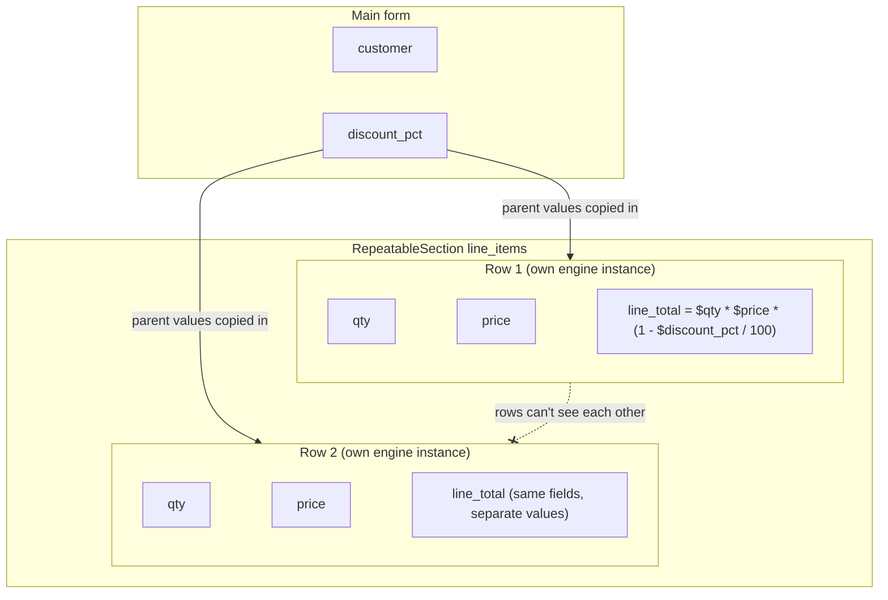

<PageBadges />

Une `RepeatableSection` permet à l'utilisateur d'ajouter autant de lignes qu'il le souhaite, comme
les lignes d'une commande. Chaque ligne contient ses propres valeurs pour le même ensemble de
champs. Cette page explique comment les lignes sont évaluées et quels champs une expression peut lire
dans le formulaire principal et dans une ligne.

## Évaluation des lignes

Dans les renderers officiels React et React Native, le formulaire principal est évalué par un moteur.
Chaque ligne est évaluée dans une instance de moteur distincte lorsqu'elle est ouverte. Le moteur de
la ligne utilise le même schéma et part d'une copie des valeurs de tout ce qui la contient, plus les
valeurs propres à la ligne :

- une ligne d'une `RepeatableSection` de premier niveau reçoit les valeurs du formulaire principal ;
- une ligne d'une `RepeatableSection` imbriquée reçoit aussi les valeurs de la ligne qui la contient.

Chaque ligne possède alors ses propres `values`, `visible`, `required`, `read_only` et `errors`.
Deux lignes ne partagent jamais d'état, même si elles utilisent les mêmes champs.

Si vous utilisez `form0-core` sans renderer officiel, le core ne crée pas les moteurs des lignes à
votre place. Votre application doit créer un moteur pour chaque évaluation de ligne et fournir les
valeurs pertinentes du formulaire principal, des lignes ancêtres et de la ligne courante.

<EngineDiagram name="repeatable-scope">

</EngineDiagram>

## Ce qu'une expression peut lire

L'endroit où une expression est définie détermine les champs qu'elle peut lire :

| Définie sur                            | Champs du formulaire principal | Champs de la même ligne | Champs des lignes qui la contiennent | Champs des autres lignes |
| -------------------------------------- | ------------------------------ | ----------------------- | ------------------------------------ | ------------------------ |
| Un champ du formulaire principal       | Oui                            | Sans objet              | Sans objet                           | Non                      |
| Un champ d'une ligne de premier niveau | Oui                            | Oui                     | Sans objet                           | Non                      |
| Un champ d'une ligne imbriquée         | Oui                            | Oui                     | Oui                                  | Non                      |

Dans l'exemple de la commande, `line_total` dans chaque ligne peut utiliser `$discount_pct` du
formulaire principal, ainsi que `$qty` et `$price` de sa propre ligne. Un champ calculé du formulaire
principal ne peut pas lire `$line_total` directement, car chaque ligne a sa propre valeur.

Les calculs et les gestionnaires d'événements de champ suivent ces règles d'accès. Une référence d'un
calcul en dehors des champs autorisés lit `undefined`, et le moteur signale un avertissement comme
`Field 'line_total' is not accessible from current context`.

Le contrôle de portée des conditions est disponible depuis core 0.6.0.

`visible_conditions`, `required_conditions` et `read_only_conditions` utilisent les mêmes portées de
lecture que le tableau ci-dessus : champs racine, de la ligne courante et des lignes ancêtres. Les
lignes descendantes, branches sœurs et branches sans lien sont inaccessibles. `validateSchema()` et
la création du moteur rejettent une référence illégale avant l'ouverture du formulaire. L'erreur
identifie l'élément propriétaire, la propriété de condition, le champ référencé et les deux chemins
d'appartenance aux enregistrements. Les clés de champ et les références par `data_name` restent prises
en charge.

Une `Section` ou `BuildingPlanSection` hérite de l'appartenance de l'enregistrement qui la contient.
Les conditions d'une `RepeatableSection` gouvernent la collection dans l'enregistrement qui la
contient ; ses champs enfants appartiennent à des lignes individuelles. Par exemple, la collection
racine `line_items` peut conditionner sa visibilité au champ racine `customer`, mais pas à son propre
champ de ligne `qty`. Une collection imbriquée dans une ligne de commande peut lire le `qty` de cette
ligne.

Chaque référence d'une règle de type tableau, AND ou OR est vérifiée, même dans une branche qui ne
serait pas évaluée car une autre détermine déjà le résultat. Les valeurs par défaut, absentes et
`not_equal_to` n'accordent aucun accès. Une violation détectée défensivement à l'exécution lève une
erreur de configuration et émet un avertissement d'accès structuré ; elle ne devient ni une erreur
intrinsèque dans `state.errors`, ni un diagnostic de calcul.

Par exemple, les scores acceptés dans `inspections` peuvent être `95` et `90`, alors que la valeur
par défaut d'`inspection_score` est `50`. Une condition de `payments.approval_note` ne peut pas
comparer directement ce champ sans lien à `80` : le schéma est rejeté au lieu d'utiliser `50 < 80`
pour exiger la note. Pour corriger une règle invalide existante, référencez un résultat explicite à
la racine ou dans un ancêtre, ou un calcul auxiliaire local fondé sur ce résultat autorisé. Si votre
application fournit `inspection_scores: [95, 90]` à la racine, un auxiliaire dans `payments` peut
calculer `SETRESULT($inspection_scores.some((score) => score < 80));` et la note peut utiliser cet
auxiliaire local dans sa condition. Le contrôle de portée des conditions n'introduit ni fonction de
collection ni actualisation automatique des lignes fermées.

## Les valeurs du parent sont une copie

Une ligne lit les valeurs du parent qui ont été copiées dans son moteur. Les renderers officiels
copient les valeurs actuelles du parent chaque fois qu'une ligne est ouverte. Modifier ensuite une
valeur du parent ne recalcule pas les autres lignes : chacune garde les valeurs calculées de sa
dernière évaluation, jusqu'à ce qu'elle soit rouverte.

## Événements et lignes

Les bindings officiels React et React Native proposent des événements portables du cycle de vie
des enregistrements et des répétables lorsque `engineOptions.events.lifecycle` est activé. Les
gestionnaires de ligne reçoivent la portée d'instance ; ouvrir une ligne ne rejoue pas les
gestionnaires de chargement racine. Sans cette activation, le déclenchement historique est conservé.
Voir [Déclenchement des événements dans les bindings officiels](/fr/core/builtins/events-overview)
pour le calendrier et les métadonnées.

Les événements d'enregistrement, comme `load-record`, ne peuvent lire que les champs racine. Les
gestionnaires d'événements de champ et de répétable suivent leur portée déclarée ; les lectures
d'ancêtres et les écritures uniquement locales restent inchangées.

## Les lignes dans l'enregistrement de sortie

Lors de la soumission du formulaire, chaque ligne devient un enregistrement enfant de
l'enregistrement principal. Voir [Sorties et enregistrements](/fr/core/output-records).

## Lectures explicites de collections

Une RepeatableSection imbriquée peut avoir plusieurs instances sans dupliquer son data_name. Une
définition `projects` contient une définition `tasks` : P1 a les coûts `[10,20]`, P2 a `[100]`. À la
racine, `REPEATABLEVALUES($tasks, 'cost')` retourne `[10,20,100]` ; dans P1, `[10,20]`. Les identités
d’ancêtres délimitent la lecture. Les branches imbriquées sans relation sont rejetées et la cible
appartient aux lignes de la section nommée. Une collection explicite appartenant à un ancêtre peut
inclure des lignes sœurs ; les permissions scalaires de lecture/écriture ne sont pas élargies.

Les collections incluent les lignes acceptées masquées ; la validation exclut séparément les ancêtres
masqués. Pour une visibilité de paiement liée aux inspections, utilisez une collection racine et un
helper booléen local. Traitez les nombres absents explicitement, par exemple
`$scores.some(score => typeof score === 'number' && score < 80)`.

Ces interfaces sont prévues après 0.6.0 et exigent une adoption des consommateurs. Le contrôle
existant de portée des conditions reste inchangé.
