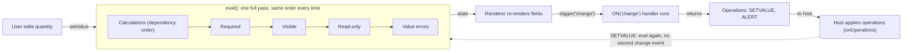

<PageBadges />

import { Callout } from "zudoku/ui/Callout"

Il motore non tiene traccia di quali campi vengono influenzati da una modifica. Ogni volta che
qualcosa cambia, esegue un passaggio di valutazione completo su tutto il modulo, sempre nello stesso
ordine. Conoscere questo ordine spiega gran parte di ciò che si vede durante l'esecuzione: perché un
campo calcolato può controllare la visibilità, perché un campo nascosto conta ancora in un calcolo e
quando vengono eseguiti i gestori di eventi.

## Creare un motore

`createFormEngine({ schema, initialValues })` prepara il modulo una sola volta:

1. Valida lo schema e genera un errore se non è valido. Vedi
   [Validazione dello schema](/it/core/schema/validation).
2. Imposta i valori: prima gli `initialValues` che passi, poi il `default_value` di ogni altro campo.
3. Determina da quali campi dipende ogni campo calcolato. Questo avviene una sola volta, non a ogni
   valutazione.
4. Esegue `form.events.code` una volta per registrare i gestori di eventi. In questa fase non viene
   attivato alcun evento.

La creazione del motore non valuta il modulo. Visibilità, obbligatorietà ed errori restano vuoti
fino alla prima chiamata a `engine.eval()`. I binding ufficiali la eseguono subito dopo aver creato
il motore.

## Un passaggio di valutazione

`engine.eval()` esegue questi passaggi in ordine, ogni volta:

<EngineDiagram name="evaluation-cycle">



</EngineDiagram>

| Passaggio         | Cosa succede                                                                                            | Risultato nello stato |
| ----------------- | ------------------------------------------------------------------------------------------------------- | --------------------- |
| 1. Calcoli        | Ogni `CalculatedField` esegue la propria espressione `calculate`, prima le dipendenze                   | `values`              |
| 2. Obbligatorietà | Viene verificato `required_conditions`, oppure si usa il flag statico `required`                        | `required`            |
| 3. Visibilità     | Viene verificato `visible_conditions`, oppure si usa il flag statico `visible`                          | `visible`             |
| 4. Sola lettura   | Viene verificato `read_only_conditions`, oppure si usa il flag statico `read_only`                      | `read_only`           |
| 5. Validazione    | Il valore di ogni campo viene controllato secondo le sue regole, come `pattern` o l'intervallo numerico | `errors`              |

Dopo il passaggio, `engine.getState()` restituisce il risultato. Gli stessi valori producono sempre
lo stesso stato, indipendentemente dall'ordine in cui l'utente li ha inseriti.

`eval()` raccoglie anche la diagnostica dei calcoli, come cicli o espressioni che generano un
errore. Leggila con `engine.getDiagnostics()`. Non modifica `errors`, le condizioni o gli eventi.
Consulta [Vedere errori e avvisi](/it/core/engine/calculations-dependencies#vedere-errori-e-avvisi).

### Cosa significa l'ordine per il tuo schema

- **Le condizioni vedono i valori calcolati.** I calcoli vengono eseguiti per primi, quindi un
  `visible_conditions` o un `required_conditions` può fare riferimento a un `CalculatedField` e
  ottiene sempre il suo valore corrente.
- **I calcoli ignorano la visibilità.** Per impostazione predefinita un campo nascosto conserva il
  suo valore, che quindi resta in `values` e continua a contare in ogni calcolo che lo usa. Per
  cancellarlo, vedi
  [Cancellare un valore quando un campo viene nascosto](/it/core/fields/common-attributes#cancellare-un-valore-quando-un-campo-viene-nascosto).
- **La validazione copre tutti i campi.** Gli errori di valore vengono calcolati anche per i campi
  nascosti. Un campo obbligatorio vuoto non è un errore in `errors`: è il renderer o la tua
  applicazione a decidere se blocca l'invio. Vedi
  [Campi obbligatori e invio](/it/core/schema/validation).
- **Le condizioni sui campi a scelta confrontano i valori selezionati.** Una condizione su un campo a
  scelta confronta il `value` della scelta selezionata, non l'intero oggetto memorizzato. Vedi
  [Condizioni e operatori](/it/core/schema/conditions-operators).

### Le sezioni seguono i propri figli

La visibilità viene valutata partendo dai campi più interni verso l'esterno. Una `Section` o una
`RepeatableSection` i cui figli sono tutti nascosti viene nascosta anch'essa, qualunque cosa dicano
i suoi `visible` o `visible_conditions`. Se almeno un figlio è visibile, valgono le impostazioni
della sezione.

## Quando un valore cambia

Il motore non ha un passaggio di "aggiornamento" separato. Quando un utente modifica un campo, i
binding ufficiali:

1. Scrivono il nuovo valore nei valori del motore.
2. Eseguono `engine.eval()`, che ripete l'intero passaggio descritto sopra.
3. Pubblicano il nuovo stato nell'interfaccia.
4. Attivano `change` per il campo modificato, eseguendo ogni gestore `ON("change", ...)`
   corrispondente.

I gestori di eventi non modificano mai il modulo da soli. Restituiscono un elenco di operazioni,
come `SETVALUE` o `ALERT`, e il renderer o la tua applicazione le applica. Applicare un `SETVALUE`
scrive il valore ed esegue di nuovo `eval()`, ma non attiva un altro evento `change`. Per questo un
gestore non può avviare una catena di eventi change impostando altri campi.

<Callout type="info" title="Gli eventi nei renderer ufficiali">
  I renderer ufficiali attivano per impostazione predefinita gli eventi del ciclo di vita, come
  `load-record` e `save-record`, oltre a `change`, `focus` e `blur`. Se usi direttamente
  `form0-core`, attiva tu gli eventi con `engine.trigger(...)`. Vedi [Attivazione degli eventi nei
  binding ufficiali](/it/core/builtins/events-overview).
</Callout>

## Usare il motore senza un renderer

Se gestisci il motore direttamente, segui la stessa sequenza usata dai binding:

```js
import { createFormEngine } from "form0-core"

const engine = createFormEngine({ schema, initialValues: { quantity: 2 } })
engine.eval()

// When the user changes a value:
engine.setValue("quantity", 3)

// Then dispatch the change event and apply the operations it returns.
const operations = engine.trigger("change", "quantity")
```

`setValue()` e `setValues()` accettano valori semplici, compreso un identificatore testuale per un
campo di scelta, ed eseguono la valutazione per te. I record salvati usano un altro formato. Vedi
[Aggiornamento e normalizzazione dei valori](/it/core/engine/value-updates).

La tua applicazione è responsabile di applicare le operazioni restituite e di decidere quando un
campo obbligatorio vuoto blocca l'invio.

## Valutare un record completo

`engine.eval()` copre un solo record. Un modulo con sezioni ripetibili è un albero: un record
principale, le sue righe e le eventuali righe al loro interno. Usa
`createRecordEvaluator({ schema, helpers, security })` quando ti serve un risultato per tutto
l'albero, ad esempio per controllare un record prima di salvarlo. Usa le stesse espressioni e regole
di ambito del motore.

```js
import { createRecordEvaluator } from "form0-core"

const evaluator = createRecordEvaluator({ schema })
const accepted = await evaluator.evaluate(snapshot)
const refreshed = await evaluator.evaluate(snapshot, { mode: "refresh" })
const prepared = await evaluator.prepareSubmission(snapshot)
```

`snapshot` ha la forma `{ values, repeatable }`. I valori usano i `data_name`, e le mappe dei
ripetibili usano le chiavi dello schema quando esistono. Ogni riga conserva il suo `id`, i `values`,
il `repeatable` annidato, gli allegati e i metadati. Per partire da un record salvato, convertilo
con [`buildFormRecordSnapshot`](/it/core/output-records#caricare-un-record-salvato).

Nessuna di queste chiamate cambia `snapshot`, salva dati, crea identificatori di record o timestamp,
o aggiorna un modulo sullo schermo.

### Mantenere o aggiornare le righe salvate

Una riga salvata conserva i suoi valori calcolati. `evaluate()` ti permette di scegliere cosa farne:

- **Per impostazione predefinita**, le righe salvate mantengono i valori calcolati, e i totali del
  record principale si ottengono da questi. Se l'importo di una riga passa da 100 a 150 e la tua
  applicazione passa quella riga salvata, il totale si aggiorna. Se l'utente annulla la modifica,
  no.
- **Con `mode: "refresh"`**, tutte le righe vengono ricalcolate insieme. Se un'imposta passa dal 10%
  al 20%, un totale salvato di 110 diventa 120 nel risultato.

La validazione e l'output usano lo stesso risultato. Un ciclo di dipendenze che attraversa più
record fallisce e non restituisce alcuno snapshot. La diagnostica dei calcoli all'interno di un
record viene riportata come sempre.

### Preparare un invio

`prepareSubmission(snapshot, options)` produce lo snapshot da salvare, dopo i calcoli e la
validazione. Controlla `eligible` prima di salvarlo.

| Opzione                | Valori                     | Predefinito   | Scopo                                                                                                 |
| ---------------------- | -------------------------- | ------------- | ----------------------------------------------------------------------------------------------------- |
| `intent`               | `"submit"`, `"draft"`      | `"submit"`    | Indica se è un invio finale o una bozza.                                                              |
| `mode`                 | `"automatic"`, `"confirm"` | `"automatic"` | Indica se le righe modificate richiedono una revisione.                                               |
| `allowRetain`          | Booleano                   | `false`       | Permette a una revisione di mantenere valori calcolati precedenti.                                    |
| `managedEvents`        | Booleano                   | `false`       | Esegue i gestori di validazione.                                                                      |
| `validateHiddenValues` | Booleano                   | `false`       | [Controlla i valori nascosti](/it/core/schema/validation#controllare-i-valori-nascosti-su-un-server). |

`status` è `ready`, `blocked`, `requires_decision`, `failed` o `cancelled`. I risultati della
validazione (`validationSummary`), i `diagnostics` dei calcoli e gli `issues` di esecuzione vengono
riportati separatamente.

Per impostazione predefinita, i valori di riga modificati vengono aggiornati automaticamente. Una
bozza (`intent: "draft"`) mantiene invece i valori calcolati salvati delle righe senza revisione, e
può risultare idonea anche con errori di validazione. Riporta comunque quegli errori e le righe non
aggiornate. Un gestore che fallisce la rende non idonea.

### Rivedere le righe modificate

Usa una revisione quando gli utenti devono vedere i valori ricalcolati prima del salvataggio. Passa
`mode: "confirm"` oppure imposta `"repeatable_recalculation": "confirm"` nel modulo.
`mode: "automatic"` non può disattivare una conferma impostata nello schema.

Se un valore di riga dovesse cambiare, `prepareSubmission()` restituisce
`status: "requires_decision"`, con `reviewId`, `proposal`, `changes`, `choices` e `snapshot: null`.
Mostra `proposal` all'utente, ma non salvarlo. Quando l'utente ha deciso, chiama di nuovo
`prepareSubmission()` con gli stessi input e le stesse opzioni, più la decisione:

```js
const prepared = await evaluator.prepareSubmission(snapshot, { mode: "confirm" })

if (prepared.status === "requires_decision") {
  showReview(prepared.proposal, prepared.changes)
}

// After the user decides, with the same evaluator, snapshot, and options:
const result = await evaluator.prepareSubmission(snapshot, {
  mode: "confirm",
  decision: { reviewId: prepared.reviewId, action: "refresh" },
})
```

`action` è `refresh`, `retain` o `cancel`. `retain` mantiene i valori calcolati precedenti e
richiede `allowRetain: true` in entrambe le chiamate. Senza, la chiamata fallisce con
`retention_not_allowed`.

Una revisione termina quando avvii un'altra preparazione, cambi gli input o le opzioni, o usi un
altro valutatore. Una decisione funziona una sola volta e applica i valori acquisiti per la
revisione.

### Salvare `freshness` con il record

`freshness` indica se i calcoli salvati di un record sono aggiornati. Un record è `pending` quando
l'utente ha mantenuto valori precedenti o ha salvato una bozza:

```js
{
  version: 1,
  status: "pending", // or "current"
  schemaRevision: "form0-bffe7ba2caa7302e",
  affected: [{ instancePath, fields: [{ fieldName, fieldKey }] }],
}
```

Salvalo accanto al record, non al suo interno, e ripristinalo perché la tua applicazione possa
mostrare quali righe non sono aggiornate. Cancella uno stato `pending` salvato solo dopo aver
salvato il risultato attuale corrispondente. Ogni preparazione parte dagli input attuali, quindi un
`freshness` salvato non può riproporre una vecchia proposta.

Ogni voce di `affected` è una riga, e `fields` elenca i campi calcolati cambiati in quella riga.
`instancePath` è il percorso completo della riga, che mantiene esatti l'identificatore zero e le
righe per posizione. Quando `status` è `current`, `affected` è vuoto.

### Gestori di validazione in un invio

Con `managedEvents: true`, `prepareSubmission()` esegue i gestori di validazione del record
principale e delle righe chiuse, con i valori attuali dei loro genitori. Non ripete gli eventi di
caricamento, modifica, salvataggio o scaricamento delle righe chiuse. `event.isValid` descrive solo
il record in cui viene eseguito il gestore. Il risultato di tutto l'albero è in `validationSummary`.

Se la tua applicazione esegue da sola i gestori di salvataggio, mantieni questo ordine: valida,
esegui il gestore di salvataggio una volta, valuta e valida di nuovo se ha cambiato dei valori, e
poi costruisci il record. Un gestore di salvataggio che cambia gli input termina una revisione
precedente, e non viene eseguito di nuovo.

### Valutazioni lunghe

Gli alberi grandi possono richiedere tempo. Passa `signal` per annullare una valutazione, `budgetMs`
per fissare un obiettivo per ogni porzione di lavoro (8 ms per impostazione predefinita) e
`yieldToHost`, una funzione asincrona che lascia rispondere la tua interfaccia tra una porzione e
l'altra. Un'espressione viene sempre eseguita fino in fondo, quindi può superare quell'obiettivo. Le
righe condividono un'unica analisi dello schema, quindi non serve un motore per ogni riga chiusa.

Le sessioni di anteprima offrono anche `runRecord({ snapshot, instancePath })` per visualizzare in
anteprima i calcoli in tutto l'albero.

## Valutare un record aperto

Usa `evaluateScope()` mentre un utente modifica un record, come una riga aperta. Valuta solo quel
record, con i valori attuali dei suoi genitori e i valori salvati delle altre righe:

```js
const editor = await evaluator.evaluateScope(snapshot, {
  instancePath: [],
  signal,
  budgetMs: 8,
  yieldToHost,
})
if (editor.status === "evaluated") {
  renderEditor(editor.state, editor.validationSummary)
}
```

Un `instancePath` vuoto seleziona il record principale. Il percorso di una riga ha un segmento per
ogni livello di annidamento. Una riga con un identificatore viene trovata con quell'identificatore,
compreso zero, e una riga senza identificatore viene trovata in base alla sua posizione nello
snapshot. Un percorso non valido fallisce con un errore.

Il risultato contiene `state`, il `validationSummary` integrato, le modifiche, la diagnostica e i
problemi di esecuzione, ma non un albero completo. La chiamata non cambia il tuo input, non aggiorna
le righe chiuse, non esegue eventi del ciclo di vita, non salva dati e non crea identificatori o
timestamp.

Ad esempio, un progetto con costi delle attività salvati `[10,20]` e una maggiorazione locale di `5`
mostra `35` mentre l'utente lo modifica. Annullare lascia invariato il totale salvato nel genitore.
Salvare il progetto mantiene quei valori e aggiorna il totale del genitore. Per inviare un record
completo, usa `prepareSubmission()`.

## Visualizzare un record senza modificarlo

Per mostrare un record salvato, crea il motore con `mode: "readonly"`. `eval()` calcola allora
condizioni e validazione dai valori che fornisci, lascia i valori calcolati come sono e non applica
i valori predefiniti mancanti. La modalità predefinita è `"edit"`.

Per consentire la modifica, chiama `setMode("edit")` e poi `eval()`. `getMode()` restituisce la
modalità attuale. Cambiare modalità non esegue di nuovo gli eventi di caricamento, non ripristina
vecchi valori del database e non salva nulla.

Per un albero di record, usa
`evaluateScope(snapshot, { interactionMode: "readonly", instancePath })`. Restituisce lo stato dei
campi e la validazione integrata dai valori che fornisci, senza calcoli.

## Cancellare i valori nascosti

Se un campo imposta
[`visible_preserve_value`](/it/core/fields/common-attributes#cancellare-un-valore-quando-un-campo-viene-nascosto)
su `false`, la valutazione lo cancella quando viene nascosto. Cancellare un valore può cambiare
calcoli e condizioni, che possono nascondere altri campi, quindi la valutazione si ripete finché
nulla cambia. Questo non esegue eventi `change` né eventi del ciclo di vita. Gli schemi che non
usano l'attributo saltano questo passaggio.

`evaluate()`, `evaluateScope()` e `prepareSubmission()` elencano ciò che hanno cancellato in
`clearedFields`:

```js
;[{ instancePath: [], fieldName: "email", fieldKey: "email" }]
```

Le voci non contengono mai il vecchio valore. Se gestisci tu lo stato del modulo, cancella i campi
elencati, compresi quelli nelle righe che non stai mostrando. Il tuo `snapshot` non cambia, e una
valutazione in sola lettura non cancella nulla. La cancellazione non influisce sul fatto che le
righe salvate mantengano o aggiornino i valori calcolati.
