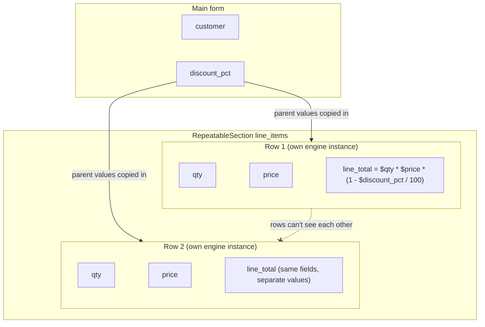

<PageBadges />

Una `RepeatableSection` permette all'utente di aggiungere un numero qualsiasi di righe, come le voci
di un ordine. Ogni riga contiene i propri valori per lo stesso insieme di campi. Questa pagina spiega
come vengono valutate le righe e quali campi un'espressione può leggere dal modulo principale e da
una riga.

## Come vengono valutate le righe

Nei renderer ufficiali React e React Native, il modulo principale viene valutato da un motore. Ogni
riga viene valutata in un'istanza di motore separata quando viene aperta. Il motore della riga usa
lo stesso schema e parte da una copia dei valori di tutto ciò che la contiene, più i valori propri
della riga:

- una riga in una `RepeatableSection` di primo livello riceve i valori del modulo principale;
- una riga in una `RepeatableSection` annidata riceve anche i valori della riga che la contiene.

Ogni riga ha quindi i propri `values`, `visible`, `required`, `read_only` ed `errors`. Due righe non
condividono mai lo stato, anche se usano gli stessi campi.

Se usi `form0-core` senza un renderer ufficiale, il core non crea i motori delle righe al posto tuo.
La tua applicazione deve creare un motore per ogni valutazione di riga e fornire i valori pertinenti
del modulo principale, delle righe antenate e della riga corrente.

<EngineDiagram name="repeatable-scope">

</EngineDiagram>

## Cosa può leggere un'espressione

Il punto in cui un'espressione è definita determina quali campi può leggere:

| Definita su                           | Campi del modulo principale | Campi della stessa riga | Campi delle righe che la contengono | Campi di altre righe |
| ------------------------------------- | --------------------------- | ----------------------- | ----------------------------------- | -------------------- |
| Un campo del modulo principale        | Sì                          | Non applicabile         | Non applicabile                     | No                   |
| Un campo in una riga di primo livello | Sì                          | Sì                      | Non applicabile                     | No                   |
| Un campo in una riga annidata         | Sì                          | Sì                      | Sì                                  | No                   |

Nell'esempio dell'ordine, `line_total` in ogni riga può usare `$discount_pct` dal modulo principale
e `$qty` e `$price` dalla propria riga. Un campo calcolato del modulo principale non può leggere
direttamente `$line_total`, perché ogni riga ha il proprio valore.

I calcoli e i gestori di eventi di campo seguono queste regole di accesso. Un riferimento di un
calcolo fuori dai campi consentiti legge `undefined` e il motore segnala un avviso come
`Field 'line_total' is not accessible from current context`.

L'applicazione degli ambiti alle condizioni descritta qui riguarda la prossima versione del core
che affronta #103. La versione pubblicata 0.5.1 non applica ancora questi controlli di appartenenza.

`visible_conditions`, `required_conditions` e `read_only_conditions` usano gli stessi ambiti di
lettura della tabella precedente: campi radice, della riga corrente e delle righe antenate. Le righe
discendenti, i rami fratelli e i rami non correlati non sono accessibili. `validateSchema()` e la
creazione del motore rifiutano un riferimento illegale prima dell'apertura del modulo. L'errore
identifica l'elemento proprietario, la proprietà della condizione, il campo referenziato e i due
percorsi di appartenenza ai record. Restano supportate le chiavi di campo e i riferimenti `data_name`.

Una `Section` o `BuildingPlanSection` eredita l'appartenenza del record che la contiene. Le condizioni
di una `RepeatableSection` governano la raccolta nel record che la contiene; i campi figli appartengono
alle singole righe. Per esempio, la raccolta radice `line_items` può condizionare la propria visibilità
al campo radice `customer`, ma non al proprio campo di riga `qty`. Una raccolta annidata in una riga
d'ordine può leggere il `qty` di quella riga.

Ogni riferimento in regole di tipo array, AND o OR viene controllato, anche in un ramo che non sarebbe
valutato perché un altro determina già il risultato. Valori predefiniti, mancanti e `not_equal_to`
non concedono accesso. Una violazione rilevata difensivamente durante l'esecuzione genera un errore
di configurazione ed emette un avviso strutturato di accesso; non diventa un errore intrinseco in
`state.errors` o una diagnostica di calcolo.

Per esempio, i punteggi accettati in `inspections` possono essere `95` e `90`, mentre il valore
predefinito di `inspection_score` è `50`. Una condizione di `payments.approval_note` non può confrontare
direttamente quel campo non correlato con `80`: lo schema viene rifiutato invece di usare `50 < 80`
per richiedere la nota. Per correggere una regola non valida esistente, usa un risultato esplicito
radice o antenato, oppure un calcolo ausiliario locale basato su quel risultato consentito. Se
l'applicazione fornisce `inspection_scores: [95, 90]` nella radice, un ausiliario in `payments` può
calcolare `SETRESULT($inspection_scores.some((score) => score < 80));` e la nota può usare tale
ausiliario locale nella condizione. L'applicazione degli ambiti alle condizioni non introduce funzioni
di raccolta o aggiornamenti automatici delle righe chiuse.

## I valori del padre sono una copia

Una riga legge i valori del padre che sono stati copiati nel suo motore. I renderer ufficiali copiano
i valori correnti del padre ogni volta che una riga viene aperta. Modificare in seguito un valore del
padre non ricalcola le altre righe: ognuna mantiene i valori calcolati dell'ultima valutazione,
finché non viene riaperta.

## Eventi e righe

I binding ufficiali React e React Native offrono eventi portabili del ciclo di vita di record e
ripetibili quando `engineOptions.events.lifecycle` è attivato. I gestori di riga ricevono l'ambito
dell'istanza; aprire una riga non ripete i gestori di caricamento della radice. Senza questa
attivazione resta disponibile l'attivazione degli eventi precedente. Vedi
[Attivazione degli eventi nei binding ufficiali](/it/core/builtins/events-overview) per tempistiche e
metadati.

Gli eventi di record, come `load-record`, possono leggere solo i campi radice. I gestori di eventi di
campo e ripetibili seguono il proprio ambito dichiarato; restano invariate le letture degli antenati
e le scritture esclusivamente locali.

## Le righe nel record di output

Quando il modulo viene inviato, ogni riga diventa un record figlio del record principale. Vedi
[Output e record](/it/core/output-records).

## Letture esplicite delle raccolte (non pubblicate)

Una RepeatableSection annidata può avere molte istanze senza duplicare il data_name. Una definizione
`projects` contiene una definizione `tasks`: P1 ha costi `[10,20]` e P2 ha `[100]`. In radice,
`REPEATABLEVALUES($tasks, 'cost')` restituisce `[10,20,100]`; dentro P1 restituisce `[10,20]`. Le
identità degli antenati delimitano la lettura. Rami annidati estranei sono rifiutati e la destinazione
deve appartenere alle righe della sezione indicata. Raccolte esplicite di un antenato possono includere
righe sorelle; le letture/scritture scalari non acquisiscono permessi.

Le raccolte includono righe accettate nascoste; la validazione esclude separatamente gli antenati
nascosti. Per visibilità dei pagamenti dipendente da ispezioni, usa una raccolta radice e un helper
booleano locale. Gestisci esplicitamente numeri assenti, per esempio
`$scores.some(score => typeof score === 'number' && score < 80)`.

Le interfacce arriveranno dopo 0.6.0 e richiedono adozione nei consumatori. Il controllo esistente
dell’ambito delle condizioni rimane invariato.
